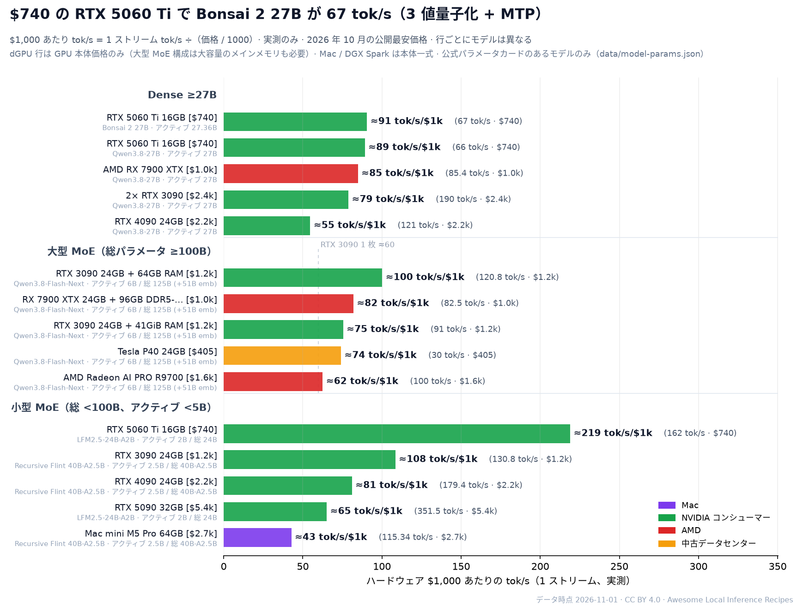
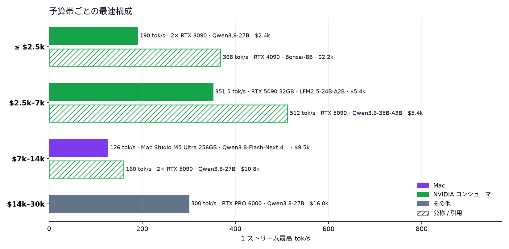

<h1 align="center">ローカル推論レシピ集 </h1>

あなたのハードウェアで、実際どれくらいの速度が出る？出典付きのローカル AI レシピ 598 件。405 ドルの GPU から 3 万ドルの構成まで。

<a href="README.md">English</a> · <a href="README.zh-CN.md">简体中文</a> · <b>日本語</b>

      

<a href="https://raytone-lab.github.io/awesome-local-inference-recipes/explore.html"><b>エクスプローラー</b></a> · <a href="recipes/README.ja.md"><b>レシピガイド</b></a> · <a href="docs/getting-started.ja.md"><b>はじめに</b></a> · <a href="https://raytone-lab.github.io/awesome-local-inference-recipes/submit.html"><b>レシピを投稿</b></a>

### X tok/s ってどれくらい速い？

同じ回答を実際の Qwen3 トークンで 10 / 20 / 50 / 100 / 200 / 500 tok/s（対数間隔）で表示し、黙読の速さ（英語で約 5 tok/s、Brysbaert 2019）やクラウド API の中央値（Artificial Analysis）と比較。 <a href="https://raytone-lab.github.io/awesome-local-inference-recipes/speed.html"><b>インタラクティブ版を試す →</b></a>

**レシピ 598 件**（テキスト 556 · 画像 16 · 動画・音声 26）· **ハードウェア 6 分類** · **エンジン 66 種** · **モデルファミリー 15 系統** · すべての数字に出典リンク · 予算 **3 万ドルまで**

### 注目の記録

| 記録               | モデル · エンジン                      | ハードウェア                                                                          | 結果                | 出典                                                                       |
| ---------------- | ------------------------------- | ------------------------------------------------------------------------------- | ----------------- | ------------------------------------------------------------------------ |
| Mac で最速          | Qwen3.8-Flash-Next · TensorFold | Mac Studio M3 Ultra（ピーク値。検証機のメモリが不明なため価格は 1 つに決まらない。発売時価格はメモリにより $3,999〜$9,499） | **130 tok/s** ✅   | [出典](https://x.com/ivanfioravanti/status/2104183112611614780)            |
| RTX 5090 1 枚で最速  | Qwen3.8-Flash-Next · Strata     | RTX 5090 + 256GB RAM · 約 5,400 ドル（GPU のみ、256GB RAM 別。実売価格、MSRP $1,999）          | **176 tok/s** ✅   | [@TechPractice1](https://x.com/TechPractice1/status/2105087037363884483) |
| AMD で最速          | Qwen3.8-Flash-Next · Strata     | AMD Radeon AI PRO R9700 · 約 1,600 ドル                                            | **100 tok/s** ✅   | [@TechPractice1](https://x.com/TechPractice1/status/2105338176055509376) |
| 中古データセンター GPU    | Qwen3.8-Flash-Next · Strata     | 2× Tesla V100 32GB PCIe                                                         | **120 tok/s** ✅   | [@rewin123](https://x.com/rewin123/status/2108669905616736529)           |
| DGX Spark 1 台で最速 | Qwen3.8-Flash-Next · TensorFold | 1× DGX Spark · 約 6,950 ドル                                                       | **130.1 tok/s** ✅ | [出典](https://x.com/Leoskie_L/status/2115262189506535697)                 |
| いちばん安い構成         | Qwen3.8-Flash-Next · Strata     | Tesla P40 24GB · 約 405 ドル                                                       | **30 tok/s** ✅    | [出典](https://github.com/Niko1221/Strata/blob/main/docs/OLDER_GPUS.md)    |

1 ストリームの生成速度で、いずれも出典からの引用です。価格は公開されている最安のハードウェア価格。✅ = 投稿者本人の実測。

## 目次

- [凡例](#凡例)
- [収録範囲](#収録範囲)
- [よくある質問](#よくある質問)
- [X で話題のレシピ](#x-で話題のレシピ)
- [ハードウェア別](#ハードウェア別)
- [モデルファミリー別](#モデルファミリー別)
- [エンジン別](#エンジン別)
- [第 1 段階 · 2,500 ドルまで](#第-1-段階--2500-ドルまで)
- [第 2 段階 · 2,500〜7,000 ドル](#第-2-段階--25007000-ドル)
- [第 3 段階 · 7,000〜14,000 ドル](#第-3-段階--700014000-ドル)
- [第 4 段階 · 14,000〜30,000 ドル](#第-4-段階--1400030000-ドル)
- [価格非公開](#価格非公開)
- [エンジンとツール](#エンジンとツール)
- [関連リスト・ベンチマーク](#関連リストベンチマーク)
- [ライセンス](#ライセンス)

## 凡例

| 出典レベル      | 意味                       | 表記                                                   |
| ---------- | ------------------------ | ---------------------------------------------------- |
| 🏛️ **公式** | 開発元やベンダーが公表した数字          | **モデル** · エンジン `量子化` — ハードウェア → **主要な数字** レベル \[出典\] |
| ✅ **実測**   | 投稿者本人が計測（ログやスクリーンショットあり） | **tok/s** は 1 ストリームの生成速度（プリフィルや合計値は含まない）             |
| 🔁 **伝聞**  | 他人の結果の引用。元の投稿で確認を        | 価格帯は公開されている最安のハードウェア価格（米ドル）で区分                       |
| 📣 **主張**  | 見込み値で、再現条件なし             | 不明な値は推定しません                                          |

## 収録範囲

このリストは、個人、家庭やオフィスのデスクトップ利用者、小規模スタジオが組める構成だけを収録します。データセンター構成は対象外です。デスクトップ PC に載せた中古データセンター GPU は対象です。

次の条件をすべて満たす構成だけを収録します：

- ハードウェアの合計価格が 3 万ドル以下。
- GPU 4 枚またはマシン 4 台まで。GPU は 1 枚ずつ、独立 GPU のないマシンは 1 台ずつ数えます。例：PC 1 台に GPU 4 枚は 4、DGX Spark 4 台は 4、DGX Spark 4 台と RTX 5090 搭載 PC 1 台は 5。
- 一般的な家庭用・オフィス用の電源で動く：合計約 2 kW 以内で、ふつうのコンセント 2 口までに分けてよく、専用の配線工事は不要。2 口を使うときは、別々の回路のコンセントにする。米国の 120 V / 15 A 回路 1 本は連続で約 1.44 kW、日本の 100 V / 15 A コンセント 1 口は定格で約 1.5 kW。
- ラック、SXM / HGX サーバーボード、カスタムループ水冷、サーバー用液冷を使わない。デスクトップに収まる DIY の SXM2→PCIe 変換構成は対象。メーカー出荷時から簡易水冷（AIO）付きのコンシューマー GPU も対象。
- ネットワークスイッチはデスクトップ型 1 台まで。
- 改造 GPU は当面対象外。メモリを変更した GPU、またはファームウェアをアンロックした GPU のことです。例：48GB メモリの RTX 4090D、アンロック済みの CMP 170HX。リストにすでにある改造 GPU のレシピは、後の見直しまで残します。

1 つでも満たさない構成は、3 万ドル未満でも対象外です。

価格は収録日の価格を記録します。後で値上がりしても、価格メモ（`hardware_cost_text`）だけを更新し、レシピは削除しません。

`python3 scripts/scope_rules.py` は、価格・台数・ハードウェア種別のチェックに通らないレシピを一覧表示します。

## よくある質問

データ時点 2026-10-28。各回答はデータセット中で最速の 1 ストリーム テキスト生成結果で、出典レベルを併記しています。✅ = 投稿者本人の実測。回答ごとにモデルは異なります。

**RTX 5090 1 枚でローカル LLM はどれくらい速い？**  
実測最速：**351.5 tok/s** — LFM2.5-24B-A2B · llama.cpp、RTX 5090 32GB（✅ 実測、2026-10-15、[出典](https://x.com/niklaslenz_ai/status/2110469931011612895)）。このハードウェアのレシピ 49 件、うち実測 27 件。

**RTX 4090 1 枚でローカル LLM はどれくらい速い？**  
実測最速：**179.4 tok/s** — Recursive Flint 40B-A2.5B · llama.cpp、RTX 4090 24GB（✅ 実測、2026-10-22、[出典](https://llm-speed.com/m/flint-40b-a2-5b)）。このハードウェアのレシピ 12 件、うち実測 5 件。

**RTX 3090 1 枚でローカル LLM はどれくらい速い？**  
実測最速：**384 tok/s** — LFM3-1.7B · llama.cpp、RTX 3090 24GB（✅ 実測、2026-10-28、[出典](https://x.com/Layton_Gott/status/2115244678056464384)）。このハードウェアのレシピ 19 件、うち実測 10 件。

**Mac Studio M3 Ultra でローカル LLM はどれくらい速い？**  
実測最速：**130 tok/s** — Qwen3.8-Flash-Next · TensorFold、Mac Studio M3 Ultra（✅ 実測、日付不明、[出典](https://x.com/ivanfioravanti/status/2104183112611614780)）。このハードウェアのレシピ 23 件、うち実測 7 件。

**NVIDIA DGX Spark 1 台でローカル LLM はどれくらい速い？**  
実測最速：**130.1 tok/s** — Qwen3.8-Flash-Next · TensorFold、1× DGX Spark（✅ 実測、2026-10-28、[出典](https://x.com/Leoskie_L/status/2115262189506535697)）。このハードウェアのレシピ 53 件、うち実測 35 件。

**AMD Strix Halo（Ryzen AI Max+ 395）でローカル LLM はどれくらい速い？**  
実測最速：**98 tok/s** — Recursive Flint 40B-A2.5B · Halogen、AMD Ryzen AI Max+ 395 128GB（✅ 実測、2026-10-23、[出典](https://www.reddit.com/r/StrixHalo/comments/1xcxjpv/)）。このハードウェアのレシピ 17 件、うち実測 8 件。

**2,500 ドル以下で実測最速の構成は？**  
実測最速：**190 tok/s** — Qwen3.8-27B · Geezuz、2× RTX 3090（✅ 実測、2026-10-20、[出典](https://github.com/ohgeebtw/geezuz-qwen3.8-27b-dual-gpu)）。この予算内のレシピ 61 件、うち実測 32 件。

## X で話題のレシピ

X で反応が多かったレシピ投稿（いいね + リポスト×3 の順。1 投稿 1 件、「主張のみ」は除外。数値は 2026-10-16 時点）。

- **DeepSeek-V4.1-Flash** — 2× DGX Spark → **29 tok/s** ✅ [@0xSero](https://x.com/0xSero/status/2106373861818224907) ♥2470
- **Qwen3.8-Flash-Next** · vLLM — 1× DGX Spark → **48.7 tok/s** ✅ [@MiaAI_lab](https://x.com/MiaAI_lab/status/2101339268203380857) ♥800
- **GLM-5.3-Flash EXL3 4-bit** · TensorFold — 2× DGX Spark → **60.4 tok/s** ✅ [@MiaAI_lab](https://x.com/MiaAI_lab/status/2105598458547646875) ♥684
- **Ternary Bonsai 2 27B** — RTX 3060 12GB → **50 tok/s** ✅ [@sudoingX](https://x.com/sudoingX/status/2110451458302943383) ♥741
- **Qwen3.8-Flash-Next** · Strata — RTX 5090 32GB → **204 tok/s** ✅ [@niklaslenz_ai](https://x.com/niklaslenz_ai/status/2110132306061013386) ♥487
- **Qwen3.8-Flash-Next** · TensorFold — 1× DGX Spark → **64.4 tok/s** ✅ [@MiaAI_lab](https://x.com/MiaAI_lab/status/2108203605685596490) ♥386
- **DeepSeek-V4-Flash (0731 GA)** — 2× DGX Spark → **82 tok/s** ✅ [@MiaAI_lab](https://x.com/MiaAI_lab/status/2083326111144906836) ♥367
- **Qwen3.8-27B** · vLLM — RTX 5090 32GB → **147 tok/s** ✅ [@MiaAI_lab](https://x.com/MiaAI_lab/status/2088734058842878037) ♥381

## ハードウェア別

デバイスごとのレシピ数と、実測で最速の 1 ストリーム tok/s（マルチ GPU は全構成中の実測最速）。クリックでハードウェアページを開きます。レシピが 5 件未満のデバイスは、絞り込み済みのエクスプローラーが開きます。

| 分類               | デバイス（レシピ数 · ⚡ 実測最速 tok/s）                                                                                                                                                                                                                                                                                                                                                                                                                                                                                                                                                                                                                                                                                                                                                          |
| ---------------- | ---------------------------------------------------------------------------------------------------------------------------------------------------------------------------------------------------------------------------------------------------------------------------------------------------------------------------------------------------------------------------------------------------------------------------------------------------------------------------------------------------------------------------------------------------------------------------------------------------------------------------------------------------------------------------------------------------------------------------------------------------------------------------------- |
| NVIDIA&nbsp;RTX  | [RTX 5090](https://raytone-lab.github.io/awesome-local-inference-recipes/hw/rtx-5090.html) (85 · ⚡**538.1**) &nbsp;·&nbsp; [RTX 3090](https://raytone-lab.github.io/awesome-local-inference-recipes/hw/rtx-3090.html) (38 · ⚡**384**) &nbsp;·&nbsp; [RTX 4090](https://raytone-lab.github.io/awesome-local-inference-recipes/hw/rtx-4090.html) (19 · ⚡**179.4**) &nbsp;·&nbsp; [RTX 5060 Ti](https://raytone-lab.github.io/awesome-local-inference-recipes/hw/rtx-5060-ti.html) (16 · ⚡**162**) &nbsp;·&nbsp; [RTX 5070 / 5070 Ti](https://raytone-lab.github.io/awesome-local-inference-recipes/explore.html?q=RTX%205070) (14 · ⚡**108.7**) &nbsp;·&nbsp; [RTX 3060](https://raytone-lab.github.io/awesome-local-inference-recipes/explore.html?q=RTX%203060) (9 · ⚡**244**)     |
| Apple&nbsp;シリコン  | [M5 Pro / M5 Max](https://raytone-lab.github.io/awesome-local-inference-recipes/hw/mac-m5.html) (49 · ⚡**157**) &nbsp;·&nbsp; [M4 Pro](https://raytone-lab.github.io/awesome-local-inference-recipes/explore.html?q=M4%20Pro) (30 · ⚡**127.9**) &nbsp;·&nbsp; [M3 Ultra](https://raytone-lab.github.io/awesome-local-inference-recipes/hw/mac-studio-m3-ultra.html) (29 · ⚡**130**) &nbsp;·&nbsp; [M5 Ultra](https://raytone-lab.github.io/awesome-local-inference-recipes/explore.html?q=M5%20Ultra) (23 · ⚡**141**) &nbsp;·&nbsp; [M4 Max](https://raytone-lab.github.io/awesome-local-inference-recipes/hw/mac-m4-max.html) (17 · ⚡**65.76**) &nbsp;·&nbsp; [M2 Ultra](https://raytone-lab.github.io/awesome-local-inference-recipes/explore.html?q=M2%20Ultra) (2 · ⚡**59.9**) |
| DGX&nbsp;Spark   | [DGX Spark](https://raytone-lab.github.io/awesome-local-inference-recipes/hw/dgx-spark.html) (120 · ⚡**130.1**)                                                                                                                                                                                                                                                                                                                                                                                                                                                                                                                                                                                                                                                                    |
| AMD              | [Radeon R9700 / RX 7900](https://raytone-lab.github.io/awesome-local-inference-recipes/hw/amd-radeon.html) (34 · ⚡**100**) &nbsp;·&nbsp; [Strix Halo](https://raytone-lab.github.io/awesome-local-inference-recipes/hw/strix-halo.html) (15 · ⚡**61**) &nbsp;·&nbsp; [Instinct MI50](https://raytone-lab.github.io/awesome-local-inference-recipes/explore.html?q=MI50) (4 · ⚡**36.8**)                                                                                                                                                                                                                                                                                                                                                                                            |
| マルチ&nbsp;GPU・その他 | [マルチ GPU 構成](https://raytone-lab.github.io/awesome-local-inference-recipes/explore.html?tag=multi-GPU) (136 · ⚡**236**) &nbsp;·&nbsp; [Tesla V100](https://raytone-lab.github.io/awesome-local-inference-recipes/explore.html?q=V100) (16 · ⚡**74.7**) &nbsp;·&nbsp; [CMP 170HX](https://raytone-lab.github.io/awesome-local-inference-recipes/explore.html?q=CMP) (6) &nbsp;·&nbsp; [iPhone](https://raytone-lab.github.io/awesome-local-inference-recipes/explore.html?q=iPhone) (4)                                                                                                                                                                                                                                                                                             |

## モデルファミリー別

ファミリー名をクリックすると、絞り込み済みのエクスプローラーが開きます。タグ：[`MoE`](https://raytone-lab.github.io/awesome-local-inference-recipes/explore.html?tag=MoE) 377, [`long-context`](https://raytone-lab.github.io/awesome-local-inference-recipes/explore.html?tag=long-context) 228, [`speculative`](https://raytone-lab.github.io/awesome-local-inference-recipes/explore.html?tag=speculative) 212, [`4bit`](https://raytone-lab.github.io/awesome-local-inference-recipes/explore.html?tag=4bit) 205, [`dense`](https://raytone-lab.github.io/awesome-local-inference-recipes/explore.html?tag=dense) 172, [`multi-GPU`](https://raytone-lab.github.io/awesome-local-inference-recipes/explore.html?tag=multi-GPU) 136, [`MTP`](https://raytone-lab.github.io/awesome-local-inference-recipes/explore.html?tag=MTP) 111, [`2bit`](https://raytone-lab.github.io/awesome-local-inference-recipes/explore.html?tag=2bit) 82, [`3bit`](https://raytone-lab.github.io/awesome-local-inference-recipes/explore.html?tag=3bit) 82, [`offload`](https://raytone-lab.github.io/awesome-local-inference-recipes/explore.html?tag=offload) 64, [`8bit`](https://raytone-lab.github.io/awesome-local-inference-recipes/explore.html?tag=8bit) 56, [`ternary`](https://raytone-lab.github.io/awesome-local-inference-recipes/explore.html?tag=ternary) 25, [`1bit`](https://raytone-lab.github.io/awesome-local-inference-recipes/explore.html?tag=1bit) 21, [`few-step`](https://raytone-lab.github.io/awesome-local-inference-recipes/explore.html?tag=few-step) 13, [`bf16`](https://raytone-lab.github.io/awesome-local-inference-recipes/explore.html?tag=bf16) 12, [`abliterated`](https://raytone-lab.github.io/awesome-local-inference-recipes/explore.html?tag=abliterated) 8, [`6bit`](https://raytone-lab.github.io/awesome-local-inference-recipes/explore.html?tag=6bit) 8, [`5bit`](https://raytone-lab.github.io/awesome-local-inference-recipes/explore.html?tag=5bit) 1。

| ファミリー                                                                                                        | レシピ数 | テキスト | 画像  | 動画・音声 |
| ------------------------------------------------------------------------------------------------------------ | ---- | ---- | --- | ----- |
| [Qwen](https://raytone-lab.github.io/awesome-local-inference-recipes/explore.html?family=Qwen)               | 316  | 316  |     |       |
| [DeepSeek](https://raytone-lab.github.io/awesome-local-inference-recipes/explore.html?family=DeepSeek)       | 91   | 91   |     |       |
| [Bonsai](https://raytone-lab.github.io/awesome-local-inference-recipes/explore.html?family=Bonsai)           | 33   | 33   |     |       |
| [GLM](https://raytone-lab.github.io/awesome-local-inference-recipes/explore.html?family=GLM)                 | 32   | 32   |     |       |
| [MiniMax H3](https://raytone-lab.github.io/awesome-local-inference-recipes/explore.html?family=MiniMax%20H3) | 18   |      |     | 18    |
| [Qwen-Image](https://raytone-lab.github.io/awesome-local-inference-recipes/explore.html?family=Qwen-Image)   | 13   |      | 13  |       |
| [Gemma](https://raytone-lab.github.io/awesome-local-inference-recipes/explore.html?family=Gemma)             | 7    | 7    |     |       |
| [LTX](https://raytone-lab.github.io/awesome-local-inference-recipes/explore.html?family=LTX)                 | 4    |      |     | 4     |
| [MiniMax](https://raytone-lab.github.io/awesome-local-inference-recipes/explore.html?family=MiniMax)         | 3    | 3    |     |       |
| [Mistral](https://raytone-lab.github.io/awesome-local-inference-recipes/explore.html?family=Mistral)         | 3    | 3    |     |       |
| [Z-Image](https://raytone-lab.github.io/awesome-local-inference-recipes/explore.html?family=Z-Image)         | 3    |      | 3   |       |
| [ACE-Step](https://raytone-lab.github.io/awesome-local-inference-recipes/explore.html?family=ACE-Step)       | 2    |      |     | 2     |
| [Edge0](https://raytone-lab.github.io/awesome-local-inference-recipes/explore.html?family=Edge0)             | 2    | 2    |     |       |
| [Wan](https://raytone-lab.github.io/awesome-local-inference-recipes/explore.html?family=Wan)                 | 2    |      |     | 2     |
| [gpt-oss](https://raytone-lab.github.io/awesome-local-inference-recipes/explore.html?family=gpt-oss)         | 2    | 2    |     |       |
| [Other](https://raytone-lab.github.io/awesome-local-inference-recipes/explore.html?family=Other)             | 67   | 67   |     |       |

## エンジン別

エンジン名は表記を統一しています（`scripts/normalize_engines.py`）。元の表記は `engine_note` に残しています。

| エンジン                                                                                                                                                                                             | レシピ数 |
| ------------------------------------------------------------------------------------------------------------------------------------------------------------------------------------------------ | ---- |
| [Strata](https://raytone-lab.github.io/awesome-local-inference-recipes/explore.html?engine=Strata)                                                                                               | 100  |
| [llama.cpp](https://raytone-lab.github.io/awesome-local-inference-recipes/explore.html?engine=llama.cpp)                                                                                         | 68   |
| [TensorFold](https://raytone-lab.github.io/awesome-local-inference-recipes/explore.html?engine=TensorFold)                                                                                       | 56   |
| [vLLM](https://raytone-lab.github.io/awesome-local-inference-recipes/explore.html?engine=vLLM)                                                                                                   | 44   |
| [oMLX](https://raytone-lab.github.io/awesome-local-inference-recipes/explore.html?engine=oMLX)                                                                                                   | 35   |
| [MLX](https://raytone-lab.github.io/awesome-local-inference-recipes/explore.html?engine=MLX)                                                                                                     | 28   |
| [SGLang](https://raytone-lab.github.io/awesome-local-inference-recipes/explore.html?engine=SGLang)                                                                                               | 17   |
| [llama.cpp (PrismML fork)](https://raytone-lab.github.io/awesome-local-inference-recipes/explore.html?engine=llama.cpp%20%28PrismML%20fork%29)                                                   | 14   |
| [ComfyUI](https://raytone-lab.github.io/awesome-local-inference-recipes/explore.html?engine=ComfyUI)                                                                                             | 13   |
| [MTPLX](https://raytone-lab.github.io/awesome-local-inference-recipes/explore.html?engine=MTPLX)                                                                                                 | 11   |
| [Splash](https://raytone-lab.github.io/awesome-local-inference-recipes/explore.html?engine=Splash)                                                                                               | 11   |
| [ExLlama](https://raytone-lab.github.io/awesome-local-inference-recipes/explore.html?engine=ExLlama)                                                                                             | 9    |
| [mlx-serve](https://raytone-lab.github.io/awesome-local-inference-recipes/explore.html?engine=mlx-serve)                                                                                         | 8    |
| [DFlash](https://raytone-lab.github.io/awesome-local-inference-recipes/explore.html?engine=DFlash)                                                                                               | 7    |
| [Project Maya](https://raytone-lab.github.io/awesome-local-inference-recipes/explore.html?engine=Project%20Maya)                                                                                 | 7    |
| [Radiance](https://raytone-lab.github.io/awesome-local-inference-recipes/explore.html?engine=Radiance)                                                                                           | 7    |
| [Ollama](https://raytone-lab.github.io/awesome-local-inference-recipes/explore.html?engine=Ollama)                                                                                               | 6    |
| [ds4 (DwarfStar)](https://raytone-lab.github.io/awesome-local-inference-recipes/explore.html?engine=ds4%20%28DwarfStar%29)                                                                       | 5    |
| [Basalt](https://raytone-lab.github.io/awesome-local-inference-recipes/explore.html?engine=Basalt)                                                                                               | 4    |
| [NVIDIA Flare](https://raytone-lab.github.io/awesome-local-inference-recipes/explore.html?engine=NVIDIA%20Flare)                                                                                 | 4    |
| [Radiance (fork)](https://raytone-lab.github.io/awesome-local-inference-recipes/explore.html?engine=Radiance%20%28fork%29)                                                                       | 4    |
| [mirai-s-ada](https://raytone-lab.github.io/awesome-local-inference-recipes/explore.html?engine=mirai-s-ada)                                                                                     | 4    |
| [Halogen](https://raytone-lab.github.io/awesome-local-inference-recipes/explore.html?engine=Halogen)                                                                                             | 3    |
| [Kapitsa](https://raytone-lab.github.io/awesome-local-inference-recipes/explore.html?engine=Kapitsa)                                                                                             | 3    |
| [Rapid-MLX](https://raytone-lab.github.io/awesome-local-inference-recipes/explore.html?engine=Rapid-MLX)                                                                                         | 3    |
| [TabbyAPI](https://raytone-lab.github.io/awesome-local-inference-recipes/explore.html?engine=TabbyAPI)                                                                                           | 3    |
| [TandemLLM](https://raytone-lab.github.io/awesome-local-inference-recipes/explore.html?engine=TandemLLM)                                                                                         | 3    |
| [gufo](https://raytone-lab.github.io/awesome-local-inference-recipes/explore.html?engine=gufo)                                                                                                   | 3    |
| [llama.cpp (agentionai fork)](https://raytone-lab.github.io/awesome-local-inference-recipes/explore.html?engine=llama.cpp%20%28agentionai%20fork%29)                                             | 3    |
| [ninfer](https://raytone-lab.github.io/awesome-local-inference-recipes/explore.html?engine=ninfer)                                                                                               | 3    |
| [BitRun](https://raytone-lab.github.io/awesome-local-inference-recipes/explore.html?engine=BitRun)                                                                                               | 2    |
| [Infernix](https://raytone-lab.github.io/awesome-local-inference-recipes/explore.html?engine=Infernix)                                                                                           | 2    |
| [MLX Swift](https://raytone-lab.github.io/awesome-local-inference-recipes/explore.html?engine=MLX%20Swift)                                                                                       | 2    |
| [Strata (Strata-DS fork)](https://raytone-lab.github.io/awesome-local-inference-recipes/explore.html?engine=Strata%20%28Strata-DS%20fork%29)                                                     | 2    |
| [TideLM](https://raytone-lab.github.io/awesome-local-inference-recipes/explore.html?engine=TideLM)                                                                                               | 2    |
| [affinity](https://raytone-lab.github.io/awesome-local-inference-recipes/explore.html?engine=affinity)                                                                                           | 2    |
| [capy-flash](https://raytone-lab.github.io/awesome-local-inference-recipes/explore.html?engine=capy-flash)                                                                                       | 2    |
| [dsx](https://raytone-lab.github.io/awesome-local-inference-recipes/explore.html?engine=dsx)                                                                                                     | 2    |
| [edge0](https://raytone-lab.github.io/awesome-local-inference-recipes/explore.html?engine=edge0)                                                                                                 | 2    |
| [llama.cpp (OpenBMB fork)](https://raytone-lab.github.io/awesome-local-inference-recipes/explore.html?engine=llama.cpp%20%28OpenBMB%20fork%29)                                                   | 2    |
| [strata-mlx](https://raytone-lab.github.io/awesome-local-inference-recipes/explore.html?engine=strata-mlx)                                                                                       | 2    |
| [tqLLM](https://raytone-lab.github.io/awesome-local-inference-recipes/explore.html?engine=tqLLM)                                                                                                 | 2    |
| [FreeToken](https://raytone-lab.github.io/awesome-local-inference-recipes/explore.html?engine=FreeToken)                                                                                         | 1    |
| [Geezuz](https://raytone-lab.github.io/awesome-local-inference-recipes/explore.html?engine=Geezuz)                                                                                               | 1    |
| [Kapitsa 0.2.19 + KFlash](https://raytone-lab.github.io/awesome-local-inference-recipes/explore.html?engine=Kapitsa%200.2.19%20%2B%20KFlash)                                                     | 1    |
| [LightX2V](https://raytone-lab.github.io/awesome-local-inference-recipes/explore.html?engine=LightX2V)                                                                                           | 1    |
| [MLX Swift (PrismML fork)](https://raytone-lab.github.io/awesome-local-inference-recipes/explore.html?engine=MLX%20Swift%20%28PrismML%20fork%29)                                                 | 1    |
| [NVIDIA Sol](https://raytone-lab.github.io/awesome-local-inference-recipes/explore.html?engine=NVIDIA%20Sol)                                                                                     | 1    |
| [Osaurus](https://raytone-lab.github.io/awesome-local-inference-recipes/explore.html?engine=Osaurus)                                                                                             | 1    |
| [Pithos](https://raytone-lab.github.io/awesome-local-inference-recipes/explore.html?engine=Pithos)                                                                                               | 1    |
| [Qwentin](https://raytone-lab.github.io/awesome-local-inference-recipes/explore.html?engine=Qwentin)                                                                                             | 1    |
| [ReVolta](https://raytone-lab.github.io/awesome-local-inference-recipes/explore.html?engine=ReVolta)                                                                                             | 1    |
| [SonicBoom](https://raytone-lab.github.io/awesome-local-inference-recipes/explore.html?engine=SonicBoom)                                                                                         | 1    |
| [VoidInfer](https://raytone-lab.github.io/awesome-local-inference-recipes/explore.html?engine=VoidInfer)                                                                                         | 1    |
| [delta-inference-engine](https://raytone-lab.github.io/awesome-local-inference-recipes/explore.html?engine=delta-inference-engine)                                                               | 1    |
| [ds41](https://raytone-lab.github.io/awesome-local-inference-recipes/explore.html?engine=ds41)                                                                                                   | 1    |
| [gbx](https://raytone-lab.github.io/awesome-local-inference-recipes/explore.html?engine=gbx)                                                                                                     | 1    |
| [llama.cpp (achyudh Adaptive KV Streaming fork)](https://raytone-lab.github.io/awesome-local-inference-recipes/explore.html?engine=llama.cpp%20%28achyudh%20Adaptive%20KV%20Streaming%20fork%29) | 1    |
| [llama.cpp (mirai-s fork)](https://raytone-lab.github.io/awesome-local-inference-recipes/explore.html?engine=llama.cpp%20%28mirai-s%20fork%29)                                                   | 1    |
| [llama.cpp (pinkmanwest fork)](https://raytone-lab.github.io/awesome-local-inference-recipes/explore.html?engine=llama.cpp%20%28pinkmanwest%20fork%29)                                           | 1    |
| [llama.cpp (vahpetr fork)](https://raytone-lab.github.io/awesome-local-inference-recipes/explore.html?engine=llama.cpp%20%28vahpetr%20fork%29)                                                   | 1    |
| [lxe Rust/CUDA runner](https://raytone-lab.github.io/awesome-local-inference-recipes/explore.html?engine=lxe%20Rust/CUDA%20runner)                                                               | 1    |
| [mflux](https://raytone-lab.github.io/awesome-local-inference-recipes/explore.html?engine=mflux)                                                                                                 | 1    |
| [rec](https://raytone-lab.github.io/awesome-local-inference-recipes/explore.html?engine=rec)                                                                                                     | 1    |
| [sparkinfer](https://raytone-lab.github.io/awesome-local-inference-recipes/explore.html?engine=sparkinfer)                                                                                       | 1    |
| [sushi](https://raytone-lab.github.io/awesome-local-inference-recipes/explore.html?engine=sushi)                                                                                                 | 1    |
| [Unspecified](https://raytone-lab.github.io/awesome-local-inference-recipes/explore.html?engine=Unspecified)                                                                                     | 64   |

## 第 1 段階 · 2,500 ドルまで

*中古の 3090/4090、MI50/V100、Strix Halo、R9700* · 70 件

**📝 テキスト**

- **Bonsai-8B** · llama.cpp (PrismML fork) `1-bit Q1_0` — RTX 4090 → **368 tok/s** 📣 [出典](https://huggingface.co/prism-ml/Bonsai-8B-gguf)
- **Qwen3.8-27B** · tqLLM `TQ3_4S-v2 · DFlash2` — RTX 3090 24GB → **273 tok/s** 🏛️ [出典](https://x.com/coffeecup2020/status/2110624499901075769)
- **Qwen3.6-35B-A3B-Escha-W2** · SGLang `Escha W2` — RTX 4090 24GB → **225 tok/s** 📣 [出典](https://huggingface.co/EschaLabs/Qwen3.6-35B-A3B-Escha-W2)
- **Qwen3.8-Flash-Next** · Strata `Strata· Swift 1.5 IQ2_XS` — RTX 4090 24GB + 32GB DDR5 → **220 tok/s** 📣 [出典](https://x.com/Knuckles_XBT/status/2105245662657011841)
- **Qwen3.8-27B** · Geezuz `Q4_K_M` — 2× RTX 3090 → **190 tok/s** ✅ [出典](https://github.com/ohgeebtw/geezuz-qwen3.8-27b-dual-gpu)
- **Recursive Flint 40B-A2.5B** · llama.cpp `NVFP4 GGUF` — RTX 4090 24GB → **179.4 tok/s** ✅ [出典](https://llm-speed.com/m/flint-40b-a2-5b)
- **Qwen3.8-27B** · tqLLM `TQ_XS· DFlash2` — RTX 5060 Ti 16GB → **175.9 tok/s** 🏛️ [出典](https://x.com/coffeecup2020/status/2110719638518526343)
- **Qwen3.6-35B-A3B** · FreeToken `FreeToken · NVFP4` — RTX 4090 → **167 tok/s** 🔁 [出典](https://x.com/shipfrontierai/status/2092602493213577481)
- **LFM2.5-24B-A2B** · llama.cpp `Q4` — RTX 5060 Ti 16GB → **162 tok/s** ✅ [出典](https://x.com/niklaslenz_ai/status/2110469931011612895)
- **Qwen3.6-35B-A3B-Escha-W2** · SGLang `Escha W2` — RTX 3090 24GB → **154 tok/s** 📣 [出典](https://huggingface.co/EschaLabs/Qwen3.6-35B-A3B-Escha-W2)
- *…ほか 51 件は[エクスプローラー](https://raytone-lab.github.io/awesome-local-inference-recipes/explore.html)で。*

**🖼️ 画像**

- **Qwen-Image 2.1** · ComfyUI `Comfy-Org INT8 · ComfyUI` — RTX 4090 24GB → 8.1 s / 1024² (40 steps); 30.2 s / 2048×1152 (50 steps); peak 16.2GB ✅ [出典](https://x.com/yume_arasaki/status/2102176739359404499) · [手順](recipes/image-001.ja.md)
- **Qwen-Image 2.1** `INT8` — RTX 3090 → 82–96 s / 2K (public receipt) 🔁 [出典](https://x.com/yume_arasaki/status/2102176739359404499)
- **Qwen-Image 2.1** · ComfyUI `ComfyUI` — Mac M4 Pro → 3 min 52 s / image (768 edit) ✅ [出典](https://x.com/gabeciii/status/2104920039077884324)
- **Z-Image Turbo** · ComfyUI `ComfyUI` — RTX 3090 24GB → 2048px about 8 s / image; another user 12 s after warm-up ✅ [出典](https://x.com/michaelricks/status/2104959036353356058)

**🎬 動画・音声**

- **FastH3 V2 / Trim** `FP8` — RTX 4090 24GB → 480p 5s: 54.6 / 43.9 s; 768p: 154.6 / 132.8 s; 8GB limit Trim 82.0 s 🏛️ [出典](https://haoailab.com/blogs/fasth3-rtx/)
- **MiniMax H3** · ComfyUI `ComfyUI` — RTX 4090 → 5 s clip ~91 s; 15 s ~8 minutes; 960×544×5s about 50 s ✅ [出典](https://x.com/yume_arasaki/status/2097790831323427046)
- **MiniMax H3** · ComfyUI `ComfyUI` — RTX 3090 → 11 s video 13 minutes ✅ [出典](https://x.com/natehalko/status/2103538997146611890)
- **ACE-Step 1.5** — RTX 3090 → Whole song <10 s (promo post) 🔁 [出典](https://x.com/simplifyinAI/status/2091935190335754493)
- **MiniMax H3 Ref2VA** · ComfyUI `INT8 DiT+ NVFP4 + Turbo 4-s…` — RTX 4090 24GB → 1344×768×5.16s (24 fps / 124 frames): warm wall time ~72 s (first run… 🏛️ [出典](https://github.com/Kablex/ComfyUI-Ref2VA-VSA)

## 第 2 段階 · 2,500〜7,000 ドル

*RTX 5090 1 枚、DGX Spark 1 台、Mac Studio Max* · 163 件

**📝 テキスト**

- **Qwen3.6-35B-A3B** · sparkinfer `sparkinfer v0.4.4` — RTX 5090 → **512 tok/s** 📣 [出典](https://x.com/kysstalol/status/2105042922643321008)
- **LFM2.5-24B-A2B** · llama.cpp `Q4` — RTX 5090 32GB → **351.5 tok/s** ✅ [出典](https://x.com/niklaslenz_ai/status/2110469931011612895)
- **NVIDIA Nemotron 3.5 Bolt 74B-A9B** · llama.cpp `NVIDIA IQ2_XXS 24GB GGUF + …` — RTX 5090 32GB → **343 tok/s** ✅ [出典](https://www.reddit.com/r/LocalLLM/comments/1xap599/)
- **gpt-oss-20b** · llama.cpp `Q4_K_M` — RTX 5090 32GB → **324.2 tok/s** ✅ [出典](https://llm-speed.com/r/r_dwp5fgdapmw)
- **Qwen3-Coder-30B-A3B-Instruct** · llama.cpp `Q4_K_M` — RTX 5090 32GB → **304.9 tok/s** ✅ [出典](https://llm-speed.com/r/r_vsype4pm1ko)
- **Qwen3.6-35B-A3B-Escha-W2** · SGLang `Escha W2` — RTX 5090 32GB → **283 tok/s** 📣 [出典](https://huggingface.co/EschaLabs/Qwen3.6-35B-A3B-Escha-W2) · [手順](recipes/hf-eschalabs-qwen3-6-35b-a3b-escha-w2-1.ja.md)
- **Qwen3.8-Flash-Next** · Basalt `NVIDIA NVFP4+ KV` — RTX 5090 32GB + Core Ultra 9 285K + 247GB DDR5 → **242 tok/s** ✅ [出典](https://www.reddit.com/r/LocalLLaMA/comments/1xcp0mf/)
- **Qwen3.8-Flash-Next** · Strata `ISTA-DASLab GSQ-RCO IQ3_S` — RTX 5090 32GB + 121GB DDR5 → **240 tok/s** ✅ [出典](https://x.com/lyesbahi/status/2113602136051458520)
- **Qwen3.8-Flash-Next** · vLLM `Intel W4A16-AutoRound + MTP` — 2× CMP 170HX+ 93GB RAM + NVMe → **226.2 tok/s** ✅ [出典](https://github.com/AlexBrandes/cmp170hx-qwen38-flash-next)
- **MiniCPM-V 4.7 35B-A3B** · llama.cpp `Q4_K_M` — RTX 5090 → **208 tok/s** ✅ [出典](https://x.com/Blackwellboy/status/2110717843121881380)
- *…ほか 135 件は[エクスプローラー](https://raytone-lab.github.io/awesome-local-inference-recipes/explore.html)で。*

**🖼️ 画像**

- **Qwen-Image 2.1** `LightX2V / BennyDaBall NVFP…` — RTX 5090 32GB → 5.93 s; NVFP4 6.7 s vs INT8 7.6 s vs BF16 15.6 s (1024²) 🔁 [出典](https://x.com/yume_arasaki/status/2103277400234860878)
- **Qwen-Image 2.1** · TensorFold `TensorFold NVFP4 / FP8 / GG…` — RTX 5090 @450W → 4.53 s / 6.94 s / 13.87 s (1024², 25 steps; NVFP4 peak 22.9GB; images… ✅ [出典](https://x.com/niklaslenz_ai/status/2106465941177487871)
- **Qwen-Image 2.1** — RTX 5090 → 13.5 s → 1.9 s / image (vendor claim) 📣 [出典](https://x.com/fractalyze_io/status/2105207217452695841)
- **Qwen-Image 2.1** · SGLang `spark-image-lab BF16 / SGLa…` — 1× DGX Spark → 52.6 s / 1024²; SGLang table: Spark 35.4 s, 4090 18.7 s 🔁 [出典](https://x.com/yume_arasaki/status/2103277400234860878)
- **Qwen-Image-2.1-Turbo** `Turbo 8 vs Base 40` — RTX 5090 → 29 s vs 108 s / image (2048²) ✅ [出典](https://x.com/niklaslenz_ai/status/2108609693941920176)
- **Z-Image Turbo vs Qwen-Image 2.1** `prompt seed 20` — RTX 5090 → Z-Image ~2× faster (no absolute times); quality: Qwen wins 9:6 ✅ [出典](https://x.com/princedoesai/status/2109376490009743713)

**🎬 動画・音声**

- **FastH3 V2** `NVFP4` — RTX 5090 32GB → 832×480×5s: 14.8 s; 1344×768×5s: 38.6 s (with audio, end-to-end) 🏛️ [出典](https://haoailab.com/blogs/fasth3-rtx/) · [手順](recipes/video-audio-001.ja.md)
- **FastH3 Trim** `NVFP4` — RTX 5090 → 480p 5s: 13.4 s; 768p: 35.4 s 🏛️ [出典](https://haoailab.com/blogs/fasth3-rtx/)
- **FastH3 V2 / Trim** `NVFP4` — 1× / 2× DGX Spark → 1×: 480p 141.4 / 125.8 s, Trim 768p 340.1 s; 2×: 87.2 / 78.3 s 🏛️ [出典](https://haoailab.com/blogs/fasth3-rtx/)
- **MiniMax H3** · ComfyUI `ComfyUI + SageAttention` — RTX 5090 → 1280×736×5s: 242 s → 168 s ✅ [出典](https://x.com/RKAScope/status/2084359480926503182)
- **MiniMax H3 vs FastH3 Turbo** `seed` — RTX 5090 → 15 s clip: 11 min 55 s vs 2 min 6 s ✅ [出典](https://x.com/Sogni_Protocol/status/2097254959729246550)
- **MiniMax H3** · NVIDIA Sol `NVIDIA Sol` — 1× DGX Spark → Sol: 480p 5 s ≈ 68 s (NVIDIA published 56 s); without Sol >400 s; wit… ✅ [出典](https://x.com/yume_arasaki/status/2100734364908986511)
- **MiniMax H3 vs LTX-2.3 Eros** `3 prompt` — 1× DGX Spark → 864×480×5s: H3 average 270 s; LTX 154 s (1.76× faster) ✅ [出典](https://x.com/YRSM_Simon/status/2084222856972456336)
- **LTX-2.3** · ComfyUI `ComfyUI` — RTX 5090 → 10 s about 90 s (weaker GPU about 6×) ✅ [出典](https://x.com/freshstartsnow/status/2092263835591655773)
- **LTX-2.5** `LoRA` — RTX 5090 → 720p/10 s: 61.11 s; 1080p/10 s: 189.90 s ✅ [出典](https://x.com/PhotogenicWeekE/status/2087298681137701274)
- **ACE-Step 1.5 + LTX-2.3** · ComfyUI `ComfyUI` — 1× DGX Spark → 2 min 05 s song generated in one pass; +2:28 lip-sync video end to en… 🔁 [出典](https://x.com/yume_arasaki/status/2100734364908986511)
- **Wan2.1 14B** `97% + 3 + FP8` — RTX 5090 → 720p: 4,769 s → 18 s (project claims 265×) 📣 [出典](https://x.com/thePandaily/status/2105209996648567243)
- **MiniMax H3** · LightX2V — RTX 5090 → 768×1344 15s video + audio ≈72 s (steady state, excl. MP4 export; bas… 🏛️ [出典](https://x.com/LightX2V/status/2108769912009424976)

## 第 3 段階 · 7,000〜14,000 ドル

*DGX Spark 2 台、Mac Studio Ultra* · 55 件

**📝 テキスト**

- **Qwen3.8-27B** · vLLM `NVFP4` — 2× RTX 5090 → **160 tok/s** 📣 [出典](https://www.reddit.com/r/LocalLLM/comments/1x5u4yf/comment/pgqv4uy/)
- **Qwen3.8-Flash-Next** · oMLX `unsloth UD-Q6_K_XL` — Mac Studio M5 Ultra 256GB → **141 tok/s** ✅ [出典](https://www.reddit.com/r/LocalLLaMA/comments/1xdp654/)
- **Qwen3.8-Flash-Next 4/8-bit** · mlx-serve `4/8-bit mixed` — Mac Studio M5 Ultra 256GB → **126 tok/s** ✅ [出典](https://x.com/LocalSilicon/status/2106175358160793817)
- **DeepSeek-V4.1-Flash** · TensorFold — 2× DGX Spark → **95 tok/s** ✅ [出典](https://x.com/Urthoo/status/2106426248759005362)
- **Qwen3.8-Flash-Next** · vLLM `nvidia FP4-Local + MTP 4` — 2× DGX Spark → **95 tok/s** 🏛️ [出典](https://github.com/atakann/dgx-spark-recipes/blob/8a15075/recipes/llm/qwen3.8-flash-next-fp4-vllm-tp2.yaml)
- **DeepSeek-V4.1-Flash-1017** · TensorFold `MiaAI EXL3 2.9bpw+ DSpark` — 2× DGX Spark → **88.7 tok/s** ✅ [出典](https://x.com/atasrb/status/2113681338532253775)
- **DeepSeek-V4-Flash (0731 GA)** `FP8` — 2× DGX Spark → **82 tok/s** ✅ [出典](https://x.com/MiaAI_lab/status/2083326111144906836)
- **DeepSeek-V4.1-Flash-1017** · TensorFold `Mia-AiLab EXL3-EAQv1 2.9bpw…` — 2× DGX Spark → **74.9 tok/s** ✅ [出典](https://github.com/MiaAI-Lab/DeepSeek-v4.1-Flash-1017-2x-DGX-Sparks)
- **DeepSeek-V4.1-Flash-1017** · TensorFold `bertholomus EXL3 2.5bpw` — 2× DGX Spark → **70.5 tok/s** ✅ [出典](https://x.com/niklaslenz_ai/status/2114094357020385570)
- **DeepSeek-V4.1-Flash-1017** · TensorFold `BobClawblaw TensorFold e2e3…` — Mac Studio M5 Ultra 80C 256GB → **67.5 tok/s** ✅ [出典](https://github.com/BobClawblaw/deepseek-v41-flash-mlx-m5-ultra)
- *…ほか 45 件は[エクスプローラー](https://raytone-lab.github.io/awesome-local-inference-recipes/explore.html)で。*

## 第 4 段階 · 14,000〜30,000 ドル

*Spark 3〜4 台のクラスター、マルチ GPU ワークステーション* · 31 件

**📝 テキスト**

- **Qwen3.8-27B** · SGLang `NVFP4` — RTX PRO 6000 → **300 tok/s** ✅ [出典](https://x.com/MiaAI_lab/status/2090327658508763516)
- **Recursive Flint 40B-A2.5B** · llama.cpp `Q8_0 GGUF` — 1× RTX PRO 6000 Blackwell 96GB → **244 tok/s** ✅ [出典](https://www.reddit.com/r/nvidia/comments/1xd0f7x/)
- **Swift-1.5-Qwen3.8-Flash-Next** · ninfer `NVFP4+FP8 · MTP 3` — RTX PRO 6000 Blackwell 96GB @ 600W + 96GB DDR4 + Ryzen 5 56… → **238 tok/s** ✅ [出典](https://demietrich.com/blog/q3.8fn_engine_comparison/)
- **Qwen3.8-Flash-Next** · vLLM `NVFP4 · MTP 2` — RTX PRO 6000 Blackwell 96GB @ 600W + 96GB DDR4 + Ryzen 5 56… → **150 tok/s** ✅ [出典](https://demietrich.com/blog/q3.8fn_engine_comparison/)
- **DeepSeek-V4.1-Flash-1017** · TensorFold `LakyFx EXL3 3.5bpw` — 3× DGX Spark → **126.1 tok/s** ✅ [出典](https://x.com/laky_fx/status/2113654994847117605)
- **DeepSeek-V4.1-Flash-1017** · TensorFold — 4× GB10 → **121 tok/s** 🏛️ [出典](https://x.com/bertholomusai/status/2113835774873600136)
- **DeepSeek-V4.1-Flash** · TensorFold — 4× DGX Spark → **111 tok/s** ✅ [出典](https://x.com/kevintheoo/status/2114654160293433558)
- **Recursive Flint 40B-A2.5B** · vLLM `NVFP4` — RTX PRO 6000 Blackwell 96GB → **110 tok/s** 📣 [出典](https://www.reddit.com/r/LocalLLaMA/comments/1xc6j8t/)
- **Qwen3.8-Flash-Next** · llama.cpp `Unsloth UD-Q4_K_XL · MTP 3` — RTX PRO 6000 Blackwell 96GB @ 600W + 96GB DDR4 + Ryzen 5 56… → **108 tok/s** ✅ [出典](https://demietrich.com/blog/q3.8fn_engine_comparison/)
- **DeepSeek-V4.1-Flash-1017** · TensorFold `bertholomus EXL3 4.0bpw + 1…` — 4× DGX Spark → **97.2 tok/s** ✅ [出典](https://github.com/tonyd2wild/DeepSeek-V4.1-Flash-TP2-and-TP4-DGX-Sparks)
- *…ほか 21 件は[エクスプローラー](https://raytone-lab.github.io/awesome-local-inference-recipes/explore.html)で。*

## 価格非公開

1 枚単位で価格が出ているマルチ GPU 構成、メモリ（＝価格）が不明な Mac など、単一の公開価格がないレシピ · 279 件。tok/s 上位のテキストレシピ：

- **Qwen3.6-35B-A3B** · SGLang `NVFP4` — 1× RTX 5090 → **626 tok/s** 🏛️ [出典](https://github.com/jhsmith409/sglang-elsa)
- **Qwen3.8-27B** · TensorFold `z-lab DFlash2` — 1× RTX 5090 → **538.1 tok/s** ✅ [出典](https://x.com/BobClawblaw/status/2114570274511405354)
- **Gemma 4 31B** · Radiance `W4A8 + DFlash2 block-16` — 4× Radeon AI PRO R9700 32GB → **445.8 tok/s** 📣 [出典](https://codeberg.org/StillDeadcode/radiance/issues/248)
- **LFM3-1.7B** · llama.cpp — RTX 3090 24GB → **384 tok/s** ✅ [出典](https://x.com/Layton_Gott/status/2115244678056464384)
- **Gemma 4 31B** · Radiance `W4A8 + RedHatAI DFlash2` — 4× Radeon AI PRO R9700 32GB → **377.7 tok/s** 📣 [出典](https://codeberg.org/StillDeadcode/radiance/issues/247)
- **Qwen3.8-Flash-Next** · Basalt `NVIDIA NVFP4` — 1× RTX 5090+ 128GB RAM → **354 tok/s** 🏛️ [出典](https://www.reddit.com/r/LocalLLaMA/comments/1xdlunp/)
- **Qwen3.8-Flash-Next** · Strata `Q2_0` — RTX 5090 + Ryzen 9 9950X → **270.7 tok/s** ✅ [出典](https://github.com/Niko1221/Strata/issues/4166)
- **Qwen3.8-27B** · TensorFold `MLX 4-bit + z-lab DFlash2` — 1× RTX 5090 32GB → **268.2 tok/s** ✅ [出典](https://x.com/niklaslenz_ai/status/2114219401679376809)
- **Qwen3.6-35B-A3B** · DFlash `DFlash 2` — Mac Studio M3 Ultra → **251 tok/s** 📣 [出典](https://x.com/tinybluedev/status/2089910202606764530)
- **LFM3-1.7B** · llama.cpp `QAD-Q4_0 KV` — RTX 3060 12GB → **244 tok/s** ✅ [出典](https://x.com/DogukanUrker/status/2115163944788566445)
- **Qwen3.8-Flash-Next** · Radiance `qwen3.8-next-flash-fp8-iq4r…` — 4× Radeon AI PRO R9700 32GB+ 122GB RAM → **236 tok/s** ✅ [出典](https://www.reddit.com/r/LocalLLaMA/comments/1xe1u1i/)
- **Qwen3.8-Flash-Next** · ExLlama `turboderp EXL3 3.18bpw_h6_n…` — 1× RTX PRO 6000 Blackwell Max-Q 96GB → **233.9 tok/s** 🏛️ [出典](https://github.com/GPTwareAiTeam/Qwen3.8-Flash-Next-1RTX6000)
- *…全 279 件は[エクスプローラー](https://raytone-lab.github.io/awesome-local-inference-recipes/explore.html)で見られます。*

## エンジンとツール

| プロジェクト                                                             | ⭐ Star | ライブ                                                                                             | 最終 push    | 概要                                                                                                                              |
| ------------------------------------------------------------------ | ------ | ----------------------------------------------------------------------------------------------- | ---------- | ------------------------------------------------------------------------------------------------------------------------------- |
| [llama.cpp](https://github.com/ggml-org/llama.cpp)                 | 131.3k |               | 2026-10-16 | GGUF の定番エンジン（CPU/CUDA/ROCm/Vulkan/Metal）。                                                                                       |
| [vLLM](https://github.com/vllm-project/vllm)                       | 93.9k  |                | 2026-10-16 | 高スループットな推論サーバー。Spark での MTP や同時実行のレシピに使われています。                                                                                  |
| [SGLang](https://github.com/sgl-project/sglang)                    | 37.2k  |               | 2026-10-16 | 推論サービング用フレームワーク。DGX Spark で DFlash2 と組み合わせて使われています。                                                                             |
| [MLX](https://github.com/ml-explore/mlx)                           | 28.8k  |                   | 2026-10-16 | Apple の配列フレームワーク。Mac のレシピの多くはこれがベース。                                                                                            |
| [Strata](https://github.com/Niko1221/Strata)                       | 25.7k  |                  | 2026-10-14 | MoE のエキスパートを VRAM・RAM・SSD に分けて載せる推論エンジン。12〜24GB の GPU 向けで、ここの Flash-Next レシピの多くが使っています。                                         |
| [ds4 (DwarfStar)](https://github.com/antirez/ds4)                  | 23.9k  |                      | 2026-10-08 | DeepSeek 4 Flash/PRO 向けのローカル推論エンジン。Metal・CUDA・ROCm に対応。                                                                         |
| [oMLX](https://github.com/jundot/omlx)                             | 22.9k  |                      | 2026-10-15 | Apple Silicon 向けの MLX サーバー。連続バッチ処理と、KV/SSD の階層キャッシュに対応。                                                                         |
| [WebLLM](https://github.com/mlc-ai/web-llm)                        | 19.3k  |                   | 2026-10-11 | WebGPU を使ってブラウザ内で LLM を動かす。                                                                                                     |
| [MNN](https://github.com/alibaba/MNN)                              | 16.2k  |                      | 2026-10-16 | Alibaba のオンデバイス推論エンジン。スマホやエッジ機器で LLM を動かす。                                                                                      |
| [turbo-fieldfare](https://github.com/drumih/turbo-fieldfare)       | 6.9k   |           | 2026-10-15 | M シリーズの MacBook で約 2GB のメモリで Gemma 4 26B-A4B を動かす（プロジェクトの説明）。                                                                   |
| [DFlash / DFlash 2](https://github.com/z-lab/dflash)               | 6.2k   |                     | 2026-08-18 | ブロック拡散による投機的デコーディング。DFlash 2 は Qwen3.8-27B 用のドラフトモデルを提供。                                                                        |
| [Lemonade](https://github.com/lemonade-sdk/lemonade)               | 5.9k   |            | 2026-10-16 | AMD Ryzen AI の NPU/iGPU などで動くローカル LLM サーバー。                                                                                     |
| [FastVideo](https://github.com/hao-ai-lab/FastVideo)               | 4.6k   |             | 2026-10-17 | 加速動画生成の統一推論・後学習フレームワーク。VSA / FastH3 の上流。                                                                                        |
| [Rapid-MLX](https://github.com/raullenchai/Rapid-MLX)              | 4.0k   |            | 2026-10-16 | Apple Silicon 向けの OpenAI/Anthropic 互換 MLX サーバー。MTP デコードと公開コミュニティベンチマークボードあり。                                                    |
| [LightX2V](https://github.com/ModelTC/LightX2V)                    | 2.9k   |                 | 2026-10-16 | 動画生成の推論フレームワーク。RTX 5090 での MiniMax H3 の結果あり。                                                                                    |
| [mlx-serve](https://github.com/ddalcu/mlx-serve)                   | 1.9k   |                 | 2026-10-16 | Apple Silicon ネイティブの LLM サーバー（Zig バックエンド＋Swift フロントエンド）。OpenAI/Anthropic API 互換で Python 不要。                                     |
| [TensorFold](https://github.com/ashhart/TensorFold)                | 1.3k   |               | 2026-10-14 | OpenAI 互換 API の MoE ランタイム。投機的デコーディング付きで、ComfyUI の MiniMax H3 にも使われています。                                                         |
| [halogen](https://github.com/peonist-ai/halogen-flash-server)      | 1.0k   |  | 2026-10-15 | Strix Halo 向けにチューニングされた Flash-Next サーバー。                                                                                        |
| [Project Maya](https://github.com/mw00/project-maya)               | 928    |                | 2026-10-16 | GLM-5.3-Flash（リポジトリ表記は 321B MoE）を NVIDIA/AMD の GPU 1〜16 枚で動かす。エンジン・サーバー・ダッシュボード・量子化ツール付き。                                       |
| [dflash-mlx](https://github.com/bstnxbt/dflash-mlx)                | 789    |               | 2026-08-20 | Apple Silicon（MLX）で動く DFlash 投機的デコーディング。                                                                                        |
| [ComfyUI-Ref2VA-VSA](https://github.com/Kablex/ComfyUI-Ref2VA-VSA) | 672    |        | 2026-10-17 | ComfyUI ノード：FastVideo の VSA ゲートを MiniMax H3 Ref2VA に移植。作者 RTX 4090 基準はネイティブ約 650s（50 ステップのデンス）→ ウォームアップ約 72s（4 ステップ VSA+Turbo）。 |
| [VDN-H3](https://github.com/OpenVDN/vdn-minimax-h3)                | 617    |           | 2026-10-05 | MiniMax H3 向け Video Delta Net ハイブリッド注意（窓付き softmax + 線形アダプタ）。T2VA / I2VA / Ref2VA 系。                                            |
| [janas](https://github.com/prabanta-dev/janas)                     | 423    |               | 2026-10-14 | 純 C 製の推論エンジン。RAM より大きいモデルを CPU/GPU で実行。32GB ノートで Qwen3-Next-80B が 37 tok/s（ドラフト使用）とプロジェクトは説明。                                   |
| [ComfyUI-VDN-H3](https://github.com/Saganaki22/ComfyUI-VDN-H3)     | 241    |        | 2026-09-12 | MiniMax H3 向け VDN-H3 ハイブリッド注意の ComfyUI ノード。                                                                                     |
| [FastH3](https://haoailab.com/blogs/fasth3-rtx/)                   | —      | *（サイト・ブログ）*                                                                                     | —          | Hao AI Lab による 8 ステップ蒸留版 MiniMax H3。RTX 向け（ブログ）。                                                                                |

⭐ スナップショットは `scripts/update_stars.py` で 2026-10-16T07:01Z（UTC）に更新 · 「ライブ」バッジは表示時に shields.io が描画します。

## 関連リスト・ベンチマーク

| プロジェクト                                                                      | ⭐ Star | ライブ                                                                                             | 最終 push    | 概要                             |
| --------------------------------------------------------------------------- | ------ | ----------------------------------------------------------------------------------------------- | ---------- | ------------------------------ |
| [Awesome-LLM-Inference](https://github.com/xlite-dev/Awesome-LLM-Inference) | 5.5k   |  | 2026-08-14 | 推論分野の論文とコードのまとめ。               |
| [awesome-local-llm](https://github.com/rafska/awesome-local-llm)            | 3.0k   |         | 2026-10-14 | ローカル LLM のプラットフォームとツールのまとめ。    |
| [LocalScore](https://github.com/cjpais/LocalScore)                          | 135    |                | 2026-10-09 | 1 GPU 向けの標準化されたベンチマーク CLI。     |
| [llamabench.ai](https://llamabench.ai/)                                     | —      | *（サイト・ブログ）*                                                                                     | —          | llama.cpp のベンチ結果を、起動コマンド付きで掲載。 |
| [llamaperf](https://llamaperf.com/leaderboard)                              | —      | *（サイト・ブログ）*                                                                                     | —          | コミュニティ投稿のリーダーボード（中央値で表示）。      |
| [canirun.ai](https://canirun.ai/)                                           | —      | *（サイト・ブログ）*                                                                                     | —          | 手持ちのハードでモデルが動くか、どれくらいの速度かを推定。  |

⭐ スナップショットは `scripts/update_stars.py` で 2026-10-16T07:01Z（UTC）に更新 · 「ライブ」バッジは表示時に shields.io が描画します。

## コントリビュート

1 レシピにつき 1 PR でお願いします。[投稿ページ](https://raytone-lab.github.io/awesome-local-inference-recipes/submit.html)の YAML テンプレートをコピーし、出典に書かれている内容だけを埋めてください（それ以外は `null`）。`node scripts/validate.mjs` でチェックし、元の投稿へのリンクを添えてください。その後 `python3 scripts/gen_readme.py` で README をすべて再生成します。新しいモデルや新しいハードウェアの発売後数週間以内のレシピと、主流ではない組み合わせを優先して収録します。定型の重複レシピは既存のエントリに統合します。詳しくは [CONTRIBUTING.md](CONTRIBUTING.md) を参照してください。

ローカル開発：`python3 -m http.server 5190` → `index.html`（トップ）· `explore.html`（絞り込み・並べ替え・散布図）· スキーマは [`schema/recipe.schema.json`](schema/recipe.schema.json)。

サイトのプレビュー

## ライセンス

- コード：[MIT](LICENSE)
- データ（`data/`）：[CC BY 4.0](LICENSE-DATA)。Awesome Local Inference Recipes と、各レシピに記載された元の出典を明記すれば自由に再利用できます。
