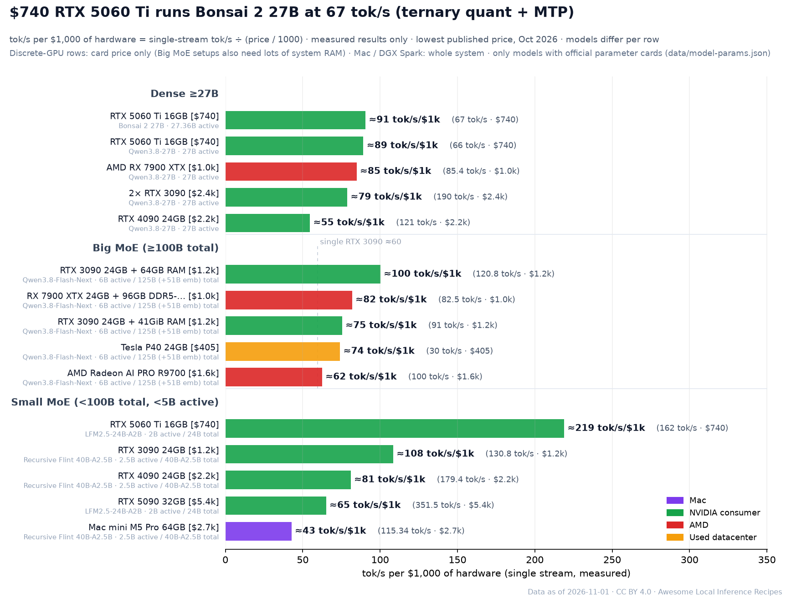
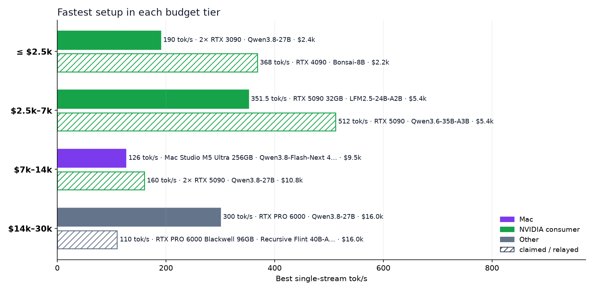
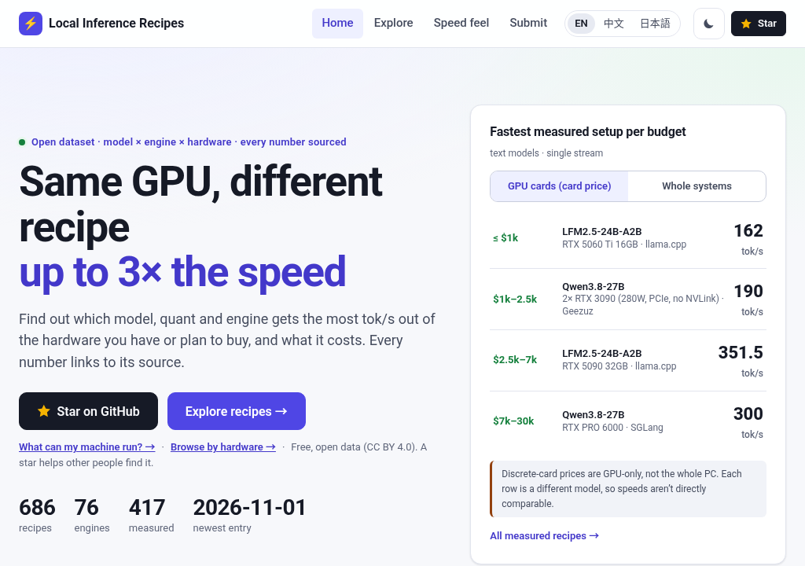

<h1 align="center">Awesome Local Inference Recipes </h1>

What speed will <b>your</b> hardware actually get? 686 source-backed local AI recipes, from a $405 GPU to a $30k rig.

<b>English</b> · <a href="README.zh-CN.md">简体中文</a> · <a href="README.ja.md">日本語</a>

      

<a href="https://raytone-lab.github.io/awesome-local-inference-recipes/explore.html?lang=en"><b>Explore live</b></a> · <a href="recipes/README.md"><b>Recipe guides</b></a> · <a href="docs/getting-started.md"><b>Getting started</b></a> · <a href="https://raytone-lab.github.io/awesome-local-inference-recipes/submit.html?lang=en"><b>Submit a recipe</b></a>

### How fast is X tok/s?

Same answer, real Qwen3 tokens, streamed at 10 / 20 / 50 / 100 / 200 / 500 tok/s (log-spaced) vs. silent reading (≈5 tok/s, Brysbaert 2019), with cloud-API medians from Artificial Analysis for comparison. <a href="https://raytone-lab.github.io/awesome-local-inference-recipes/speed.html?lang=en"><b>Try it interactively →</b></a>

**686 recipes** (645 text · 15 image · 26 video & audio) · **6 hardware families** · **90 engines** · **16 model families** · every number linked to its source · budget up to **$30k**

### Headline numbers

| Record                   | Model · engine                  | Hardware                                                                                                                              | Result            | Source                                                                    |
| ------------------------ | ------------------------------- | ------------------------------------------------------------------------------------------------------------------------------------- | ----------------- | ------------------------------------------------------------------------- |
| Fastest on a Mac         | Qwen3.8-Flash-Next · TensorFold | Mac Studio M3 Ultra (peak figure; test machine memory not stated, so no single price; launch price $3,999–$9,499 depending on memory) | **130 tok/s** ✅   | [source](https://x.com/ivanfioravanti/status/2104183112611614780)         |
| Fastest on one RTX 5090  | Qwen3.8-Flash-Next · Strata     | RTX 5090 + 256GB RAM · ≈ $5,400 (card only, excl. 256GB RAM; street price, MSRP $1,999)                                               | **176 tok/s** ✅   | [@TechPractice1](https://x.com/TechPractice1/status/2105087037363884483)  |
| Fastest on AMD           | Qwen3.8-Flash-Next · Strata     | AMD Radeon AI PRO R9700 · ≈ $1,600                                                                                                    | **100 tok/s** ✅   | [@TechPractice1](https://x.com/TechPractice1/status/2105338176055509376)  |
| Used datacenter GPUs     | Qwen3.8-Flash-Next · Strata     | 2× Tesla V100 32GB PCIe                                                                                                               | **120 tok/s** ✅   | [@rewin123](https://x.com/rewin123/status/2108669905616736529)            |
| Fastest on one DGX Spark | Qwen3.8-Flash-Next · TensorFold | 1× DGX Spark · ≈ $6,950                                                                                                               | **130.1 tok/s** ✅ | [source](https://x.com/Leoskie_L/status/2115262189506535697)              |
| Cheapest rig in the list | Qwen3.8-Flash-Next · Strata     | Tesla P40 24GB · ≈ $405                                                                                                               | **30 tok/s** ✅    | [source](https://github.com/Niko1221/Strata/blob/main/docs/OLDER_GPUS.md) |

Single-stream generation speed, copied from each source; prices are the lowest published hardware price. ✅ = measured by the poster.

## Contents

- [Legend](#legend)
- [Scope](#scope)
- [Quick answers](#quick-answers)
- [Popular on X](#popular-on-x)
- [Browse by Hardware](#browse-by-hardware)
- [Browse by Model Family](#browse-by-model-family)
- [Browse by Engine](#browse-by-engine)
- [Tier 1 · up to $2.5k](#tier-1--up-to-25k)
- [Tier 2 · $2.5k–7k](#tier-2--25k7k)
- [Tier 3 · $7k–14k](#tier-3--7k14k)
- [Tier 4 · $14k–30k](#tier-4--14k30k)
- [Cost Not Published](#cost-not-published)
- [Engines & Tools](#engines--tools)
- [Related Lists & Benchmarks](#related-lists--benchmarks)
- [License](#license)

## Legend

| Source level     | Meaning                                                                                                             | Format                                                                  |
| ---------------- | ------------------------------------------------------------------------------------------------------------------- | ----------------------------------------------------------------------- |
| 🏛️ **Official** | vendor or project number                                                                                            | **Model** · Engine `quant` — Hardware → **key number** level \[source\] |
| ✅ **Measured**   | poster ran it, with log or screenshot; an engine or recipe author must also publish raw data and reproduction steps | **tok/s** = single-stream generation (not prefill, not aggregate)       |
| 🔁 **Relayed**   | second-hand, verify upstream                                                                                        | Tiers use the lowest published hardware price (USD)                     |
| 📣 **Claimed**   | projection, no reproduction                                                                                         | Unknown values are never estimated                                      |

## Scope

This list is for setups that one person, a home or office desktop user, or a small studio can build. Datacenter setups are out of scope. Used datacenter cards in a desktop PC are in scope.

A setup is in scope only when it meets all of these conditions:

- The hardware costs $30,000 or less.
- It has at most 4 GPUs or 4 machines. Count each GPU, and each machine without a separate GPU. For example: 4 GPUs in one PC count as 4, 4 DGX Sparks count as 4, and 4 DGX Sparks plus 1 PC with an RTX 5090 count as 5.
- It runs on ordinary home or office power: about 2 kW in total, from up to two ordinary outlets, with no special wiring. If you use two outlets, put them on separate circuits. One US 120 V / 15 A circuit gives about 1.44 kW continuous. One Japanese 100 V / 15 A outlet is rated at about 1.5 kW.
- It uses no rack, no SXM or HGX server board, no custom liquid-cooling loop and no server liquid cooling. A DIY SXM2-to-PCIe adapter build that fits in a desktop is in scope. A consumer GPU with a factory all-in-one (AIO) liquid cooler is in scope.
- It uses at most one desktop-class network switch.
- It uses no modded GPU. For now, a GPU with changed memory or unlocked firmware is out of scope. Examples are an RTX 4090D with 48GB memory and an unlocked CMP 170HX. Recipes for modded GPUs that are already in the list stay until a later review.

A setup that fails one condition is out of scope, even when it costs less than $30,000.

We record the price on the date that we add the recipe. When the price goes up later, we update only the price note (`hardware_cost_text`). We do not remove the recipe.

`python3 scripts/scope_rules.py` lists the recipes that fail the cost, count or hardware-type check.

## Quick answers

Data as of 2026-11-01. Each answer is the fastest single-stream text result in the dataset with its trust level; ✅ = measured by the poster. Models differ between answers.

**How fast is a single RTX 5090 for local LLMs?**  
Fastest measured: **351.5 tok/s** — LFM2.5-24B-A2B · llama.cpp on RTX 5090 32GB (✅ measured, 2026-10-15, [source](https://x.com/niklaslenz_ai/status/2110469931011612895)). 49 recipe(s) for this hardware, 27 measured.

**How fast is a single RTX 4090 for local LLMs?**  
Fastest measured: **179.4 tok/s** — Recursive Flint 40B-A2.5B · llama.cpp on RTX 4090 24GB (✅ measured, 2026-10-22, [source](https://llm-speed.com/m/flint-40b-a2-5b)). 13 recipe(s) for this hardware, 5 measured.

**How fast is a single RTX 3090 for local LLMs?**  
Fastest measured: **384 tok/s** — LFM3-1.7B · llama.cpp on RTX 3090 24GB (✅ measured, 2026-10-28, [source](https://x.com/Layton_Gott/status/2115244678056464384)). 19 recipe(s) for this hardware, 10 measured.

**How fast is a Mac Studio M3 Ultra for local LLMs?**  
Fastest measured: **130 tok/s** — Qwen3.8-Flash-Next · TensorFold on Mac Studio M3 Ultra (✅ measured, date not stated, [source](https://x.com/ivanfioravanti/status/2104183112611614780)). 23 recipe(s) for this hardware, 7 measured.

**How fast is one NVIDIA DGX Spark for local LLMs?**  
Fastest measured: **130.1 tok/s** — Qwen3.8-Flash-Next · TensorFold on 1× DGX Spark (✅ measured, 2026-10-28, [source](https://x.com/Leoskie_L/status/2115262189506535697)). 59 recipe(s) for this hardware, 39 measured.

**How fast is an AMD Strix Halo (Ryzen AI Max+ 395) for local LLMs?**  
Fastest measured: **98 tok/s** — Recursive Flint 40B-A2.5B · Halogen on AMD Ryzen AI Max+ 395 128GB (✅ measured, 2026-10-23, [source](https://www.reddit.com/r/StrixHalo/comments/1xcxjpv/)). 22 recipe(s) for this hardware, 10 measured.

**What is the fastest measured setup under $2,500?**  
Fastest measured: **190 tok/s** — Qwen3.8-27B · Geezuz on 2× RTX 3090 (✅ measured, 2026-10-20, [source](https://github.com/ohgeebtw/geezuz-qwen3.8-27b-dual-gpu)). 61 recipe(s) in this budget, 32 measured.

## Popular on X

Most-engaged recipe posts on X (likes + 3×reposts; one entry per post, claimed-only results left out; counts as of 2026-10-30).

- **DeepSeek-V4.1-Flash** — 2× DGX Spark → **29 tok/s** ✅ [@0xSero](https://x.com/0xSero/status/2106373861818224907) ♥2459
- **Ternary Bonsai 2 27B** — RTX 3060 12GB → **50 tok/s** ✅ [@sudoingX](https://x.com/sudoingX/status/2110451458302943383) ♥811
- **Qwen3.8-Flash-Next** · vLLM — 1× DGX Spark → **48.7 tok/s** ✅ [@MiaAI_lab](https://x.com/MiaAI_lab/status/2101339268203380857) ♥800
- **GLM-5.3-Flash EXL3 4-bit** · TensorFold — 2× DGX Spark → **60.4 tok/s** ✅ [@MiaAI_lab](https://x.com/MiaAI_lab/status/2105598458547646875) ♥683
- **Qwen3.8-Flash-Next** · Strata — RTX 5090 32GB → **204 tok/s** ✅ [@niklaslenz_ai](https://x.com/niklaslenz_ai/status/2110132306061013386) ♥503
- **Qwen3.8-Flash-Next** · TensorFold — 1× DGX Spark → **64.4 tok/s** ✅ [@MiaAI_lab](https://x.com/MiaAI_lab/status/2108203605685596490) ♥386
- **DeepSeek-V4-Flash (0731 GA)** — 2× DGX Spark → **82 tok/s** ✅ [@MiaAI_lab](https://x.com/MiaAI_lab/status/2083326111144906836) ♥365
- **Qwen3.8-27B** · vLLM — RTX 5090 32GB → **147 tok/s** ✅ [@MiaAI_lab](https://x.com/MiaAI_lab/status/2088734058842878037) ♥377

## Browse by Hardware

Recipe count and the fastest measured single-stream tok/s for each device (multi-GPU rigs: fastest measured on any rig). Links open the hardware page, or the explorer pre-filtered when a device has fewer than 5 recipes.

| Family                      | Device (recipes · ⚡ fastest measured tok/s)                                                                                                                                                                                                                                                                                                                                                                                                                                                                                                                                                                                                                                                                                                                                                               |
| --------------------------- | --------------------------------------------------------------------------------------------------------------------------------------------------------------------------------------------------------------------------------------------------------------------------------------------------------------------------------------------------------------------------------------------------------------------------------------------------------------------------------------------------------------------------------------------------------------------------------------------------------------------------------------------------------------------------------------------------------------------------------------------------------------------------------------------------------- |
| NVIDIA&nbsp;RTX             | [RTX 5090](https://raytone-lab.github.io/awesome-local-inference-recipes/hw/rtx-5090.html) (92 · ⚡**538.1**) &nbsp;·&nbsp; [RTX 3090](https://raytone-lab.github.io/awesome-local-inference-recipes/hw/rtx-3090.html) (39 · ⚡**384**) &nbsp;·&nbsp; [RTX 4090](https://raytone-lab.github.io/awesome-local-inference-recipes/hw/rtx-4090.html) (23 · ⚡**179.4**) &nbsp;·&nbsp; [RTX 5060 Ti](https://raytone-lab.github.io/awesome-local-inference-recipes/hw/rtx-5060-ti.html) (17 · ⚡**162**) &nbsp;·&nbsp; [RTX 5070 / 5070 Ti](https://raytone-lab.github.io/awesome-local-inference-recipes/explore.html?q=RTX%205070&lang=en) (15 · ⚡**108.7**) &nbsp;·&nbsp; [RTX 3060](https://raytone-lab.github.io/awesome-local-inference-recipes/explore.html?q=RTX%203060&lang=en) (13 · ⚡**244**)           |
| Apple&nbsp;Silicon          | [M5 Pro / M5 Max](https://raytone-lab.github.io/awesome-local-inference-recipes/hw/mac-m5.html) (52 · ⚡**157**) &nbsp;·&nbsp; [M3 Ultra](https://raytone-lab.github.io/awesome-local-inference-recipes/hw/mac-studio-m3-ultra.html) (30 · ⚡**130**) &nbsp;·&nbsp; [M4 Pro](https://raytone-lab.github.io/awesome-local-inference-recipes/explore.html?q=M4%20Pro&lang=en) (30 · ⚡**127.9**) &nbsp;·&nbsp; [M5 Ultra](https://raytone-lab.github.io/awesome-local-inference-recipes/explore.html?q=M5%20Ultra&lang=en) (30 · ⚡**141**) &nbsp;·&nbsp; [M4 Max](https://raytone-lab.github.io/awesome-local-inference-recipes/hw/mac-m4-max.html) (19 · ⚡**78.7**) &nbsp;·&nbsp; [M2 Ultra](https://raytone-lab.github.io/awesome-local-inference-recipes/explore.html?q=M2%20Ultra&lang=en) (2 · ⚡**59.9**) |
| DGX&nbsp;Spark              | [DGX Spark](https://raytone-lab.github.io/awesome-local-inference-recipes/hw/dgx-spark.html) (138 · ⚡**130.1**)                                                                                                                                                                                                                                                                                                                                                                                                                                                                                                                                                                                                                                                                                           |
| AMD                         | [Radeon R9700 / RX 7900](https://raytone-lab.github.io/awesome-local-inference-recipes/hw/amd-radeon.html) (39 · ⚡**100**) &nbsp;·&nbsp; [Strix Halo](https://raytone-lab.github.io/awesome-local-inference-recipes/hw/strix-halo.html) (19 · ⚡**61**) &nbsp;·&nbsp; [Instinct MI50](https://raytone-lab.github.io/awesome-local-inference-recipes/explore.html?q=MI50&lang=en) (5 · ⚡**36.8**)                                                                                                                                                                                                                                                                                                                                                                                                           |
| Multi-GPU&nbsp;&&nbsp;other | [Multi-GPU rigs](https://raytone-lab.github.io/awesome-local-inference-recipes/explore.html?tag=multi-GPU&lang=en) (166 · ⚡**370**) &nbsp;·&nbsp; [Tesla V100](https://raytone-lab.github.io/awesome-local-inference-recipes/explore.html?q=V100&lang=en) (17 · ⚡**74.7**) &nbsp;·&nbsp; [CMP 170HX](https://raytone-lab.github.io/awesome-local-inference-recipes/explore.html?q=CMP&lang=en) (6) &nbsp;·&nbsp; [iPhone](https://raytone-lab.github.io/awesome-local-inference-recipes/explore.html?q=iPhone&lang=en) (4)                                                                                                                                                                                                                                                                                |

## Browse by Model Family

Click a family to open the explorer pre-filtered. Tags: [`MoE`](https://raytone-lab.github.io/awesome-local-inference-recipes/explore.html?tag=MoE&lang=en) 450, [`long-context`](https://raytone-lab.github.io/awesome-local-inference-recipes/explore.html?tag=long-context&lang=en) 259, [`speculative`](https://raytone-lab.github.io/awesome-local-inference-recipes/explore.html?tag=speculative&lang=en) 247, [`4bit`](https://raytone-lab.github.io/awesome-local-inference-recipes/explore.html?tag=4bit&lang=en) 239, [`dense`](https://raytone-lab.github.io/awesome-local-inference-recipes/explore.html?tag=dense&lang=en) 189, [`multi-GPU`](https://raytone-lab.github.io/awesome-local-inference-recipes/explore.html?tag=multi-GPU&lang=en) 166, [`MTP`](https://raytone-lab.github.io/awesome-local-inference-recipes/explore.html?tag=MTP&lang=en) 135, [`3bit`](https://raytone-lab.github.io/awesome-local-inference-recipes/explore.html?tag=3bit&lang=en) 97, [`2bit`](https://raytone-lab.github.io/awesome-local-inference-recipes/explore.html?tag=2bit&lang=en) 95, [`offload`](https://raytone-lab.github.io/awesome-local-inference-recipes/explore.html?tag=offload&lang=en) 73, [`8bit`](https://raytone-lab.github.io/awesome-local-inference-recipes/explore.html?tag=8bit&lang=en) 49, [`1bit`](https://raytone-lab.github.io/awesome-local-inference-recipes/explore.html?tag=1bit&lang=en) 25, [`ternary`](https://raytone-lab.github.io/awesome-local-inference-recipes/explore.html?tag=ternary&lang=en) 25, [`few-step`](https://raytone-lab.github.io/awesome-local-inference-recipes/explore.html?tag=few-step&lang=en) 12, [`bf16`](https://raytone-lab.github.io/awesome-local-inference-recipes/explore.html?tag=bf16&lang=en) 11, [`abliterated`](https://raytone-lab.github.io/awesome-local-inference-recipes/explore.html?tag=abliterated&lang=en) 10, [`6bit`](https://raytone-lab.github.io/awesome-local-inference-recipes/explore.html?tag=6bit&lang=en) 8, [`5bit`](https://raytone-lab.github.io/awesome-local-inference-recipes/explore.html?tag=5bit&lang=en) 1.

| Family                                                                                                               | Recipes | Text | Image | Video & Audio |
| -------------------------------------------------------------------------------------------------------------------- | ------- | ---- | ----- | ------------- |
| [Qwen](https://raytone-lab.github.io/awesome-local-inference-recipes/explore.html?family=Qwen&lang=en)               | 365     | 365  |       |               |
| [DeepSeek](https://raytone-lab.github.io/awesome-local-inference-recipes/explore.html?family=DeepSeek&lang=en)       | 106     | 106  |       |               |
| [GLM](https://raytone-lab.github.io/awesome-local-inference-recipes/explore.html?family=GLM&lang=en)                 | 36      | 36   |       |               |
| [Bonsai](https://raytone-lab.github.io/awesome-local-inference-recipes/explore.html?family=Bonsai&lang=en)           | 33      | 33   |       |               |
| [MiniMax H3](https://raytone-lab.github.io/awesome-local-inference-recipes/explore.html?family=MiniMax%20H3&lang=en) | 18      |      |       | 18            |
| [Qwen-Image](https://raytone-lab.github.io/awesome-local-inference-recipes/explore.html?family=Qwen-Image&lang=en)   | 13      |      | 13    |               |
| [Gemma](https://raytone-lab.github.io/awesome-local-inference-recipes/explore.html?family=Gemma&lang=en)             | 8       | 8    |       |               |
| [LTX](https://raytone-lab.github.io/awesome-local-inference-recipes/explore.html?family=LTX&lang=en)                 | 4       |      |       | 4             |
| [MiniMax](https://raytone-lab.github.io/awesome-local-inference-recipes/explore.html?family=MiniMax&lang=en)         | 4       | 4    |       |               |
| [Mistral](https://raytone-lab.github.io/awesome-local-inference-recipes/explore.html?family=Mistral&lang=en)         | 3       | 3    |       |               |
| [gpt-oss](https://raytone-lab.github.io/awesome-local-inference-recipes/explore.html?family=gpt-oss&lang=en)         | 3       | 3    |       |               |
| [ACE-Step](https://raytone-lab.github.io/awesome-local-inference-recipes/explore.html?family=ACE-Step&lang=en)       | 2       |      |       | 2             |
| [Edge0](https://raytone-lab.github.io/awesome-local-inference-recipes/explore.html?family=Edge0&lang=en)             | 2       | 2    |       |               |
| [Wan](https://raytone-lab.github.io/awesome-local-inference-recipes/explore.html?family=Wan&lang=en)                 | 2       |      |       | 2             |
| [Z-Image](https://raytone-lab.github.io/awesome-local-inference-recipes/explore.html?family=Z-Image&lang=en)         | 2       |      | 2     |               |
| [Llama](https://raytone-lab.github.io/awesome-local-inference-recipes/explore.html?family=Llama&lang=en)             | 1       | 1    |       |               |
| [Other](https://raytone-lab.github.io/awesome-local-inference-recipes/explore.html?family=Other&lang=en)             | 84      | 84   |       |               |

## Browse by Engine

Engine names are normalized (`scripts/normalize_engines.py`); original strings are kept in `engine_note`.

| Engine                                                                                                                                                                                                   | Recipes |
| -------------------------------------------------------------------------------------------------------------------------------------------------------------------------------------------------------- | ------- |
| [Strata](https://raytone-lab.github.io/awesome-local-inference-recipes/explore.html?engine=Strata&lang=en)                                                                                               | 126     |
| [llama.cpp](https://raytone-lab.github.io/awesome-local-inference-recipes/explore.html?engine=llama.cpp&lang=en)                                                                                         | 75      |
| [TensorFold](https://raytone-lab.github.io/awesome-local-inference-recipes/explore.html?engine=TensorFold&lang=en)                                                                                       | 62      |
| [vLLM](https://raytone-lab.github.io/awesome-local-inference-recipes/explore.html?engine=vLLM&lang=en)                                                                                                   | 55      |
| [oMLX](https://raytone-lab.github.io/awesome-local-inference-recipes/explore.html?engine=oMLX&lang=en)                                                                                                   | 36      |
| [MLX](https://raytone-lab.github.io/awesome-local-inference-recipes/explore.html?engine=MLX&lang=en)                                                                                                     | 31      |
| [SGLang](https://raytone-lab.github.io/awesome-local-inference-recipes/explore.html?engine=SGLang&lang=en)                                                                                               | 20      |
| [llama.cpp (PrismML fork)](https://raytone-lab.github.io/awesome-local-inference-recipes/explore.html?engine=llama.cpp%20%28PrismML%20fork%29&lang=en)                                                   | 14      |
| [ComfyUI](https://raytone-lab.github.io/awesome-local-inference-recipes/explore.html?engine=ComfyUI&lang=en)                                                                                             | 12      |
| [Splash](https://raytone-lab.github.io/awesome-local-inference-recipes/explore.html?engine=Splash&lang=en)                                                                                               | 12      |
| [MTPLX](https://raytone-lab.github.io/awesome-local-inference-recipes/explore.html?engine=MTPLX&lang=en)                                                                                                 | 11      |
| [ExLlama](https://raytone-lab.github.io/awesome-local-inference-recipes/explore.html?engine=ExLlama&lang=en)                                                                                             | 9       |
| [mlx-serve](https://raytone-lab.github.io/awesome-local-inference-recipes/explore.html?engine=mlx-serve&lang=en)                                                                                         | 8       |
| [DFlash](https://raytone-lab.github.io/awesome-local-inference-recipes/explore.html?engine=DFlash&lang=en)                                                                                               | 7       |
| [Ollama](https://raytone-lab.github.io/awesome-local-inference-recipes/explore.html?engine=Ollama&lang=en)                                                                                               | 7       |
| [Project Maya](https://raytone-lab.github.io/awesome-local-inference-recipes/explore.html?engine=Project%20Maya&lang=en)                                                                                 | 7       |
| [Radiance](https://raytone-lab.github.io/awesome-local-inference-recipes/explore.html?engine=Radiance&lang=en)                                                                                           | 7       |
| [ds4 (DwarfStar)](https://raytone-lab.github.io/awesome-local-inference-recipes/explore.html?engine=ds4%20%28DwarfStar%29&lang=en)                                                                       | 5       |
| [Basalt](https://raytone-lab.github.io/awesome-local-inference-recipes/explore.html?engine=Basalt&lang=en)                                                                                               | 4       |
| [NVIDIA Flare](https://raytone-lab.github.io/awesome-local-inference-recipes/explore.html?engine=NVIDIA%20Flare&lang=en)                                                                                 | 4       |
| [Radiance (fork)](https://raytone-lab.github.io/awesome-local-inference-recipes/explore.html?engine=Radiance%20%28fork%29&lang=en)                                                                       | 4       |
| [mirai-s-ada](https://raytone-lab.github.io/awesome-local-inference-recipes/explore.html?engine=mirai-s-ada&lang=en)                                                                                     | 4       |
| [ninfer](https://raytone-lab.github.io/awesome-local-inference-recipes/explore.html?engine=ninfer&lang=en)                                                                                               | 4       |
| [Halogen](https://raytone-lab.github.io/awesome-local-inference-recipes/explore.html?engine=Halogen&lang=en)                                                                                             | 3       |
| [Kapitsa](https://raytone-lab.github.io/awesome-local-inference-recipes/explore.html?engine=Kapitsa&lang=en)                                                                                             | 3       |
| [Rapid-MLX](https://raytone-lab.github.io/awesome-local-inference-recipes/explore.html?engine=Rapid-MLX&lang=en)                                                                                         | 3       |
| [TabbyAPI](https://raytone-lab.github.io/awesome-local-inference-recipes/explore.html?engine=TabbyAPI&lang=en)                                                                                           | 3       |
| [TandemLLM](https://raytone-lab.github.io/awesome-local-inference-recipes/explore.html?engine=TandemLLM&lang=en)                                                                                         | 3       |
| [gufo](https://raytone-lab.github.io/awesome-local-inference-recipes/explore.html?engine=gufo&lang=en)                                                                                                   | 3       |
| [llama.cpp (agentionai fork)](https://raytone-lab.github.io/awesome-local-inference-recipes/explore.html?engine=llama.cpp%20%28agentionai%20fork%29&lang=en)                                             | 3       |
| [BitRun](https://raytone-lab.github.io/awesome-local-inference-recipes/explore.html?engine=BitRun&lang=en)                                                                                               | 2       |
| [Espetero](https://raytone-lab.github.io/awesome-local-inference-recipes/explore.html?engine=Espetero&lang=en)                                                                                           | 2       |
| [Front_Eagle739 streaming stack](https://raytone-lab.github.io/awesome-local-inference-recipes/explore.html?engine=Front_Eagle739%20streaming%20stack&lang=en)                                           | 2       |
| [Infernix](https://raytone-lab.github.io/awesome-local-inference-recipes/explore.html?engine=Infernix&lang=en)                                                                                           | 2       |
| [MLX Swift](https://raytone-lab.github.io/awesome-local-inference-recipes/explore.html?engine=MLX%20Swift&lang=en)                                                                                       | 2       |
| [Strata (Strata-DS fork)](https://raytone-lab.github.io/awesome-local-inference-recipes/explore.html?engine=Strata%20%28Strata-DS%20fork%29&lang=en)                                                     | 2       |
| [TideLM](https://raytone-lab.github.io/awesome-local-inference-recipes/explore.html?engine=TideLM&lang=en)                                                                                               | 2       |
| [affinity](https://raytone-lab.github.io/awesome-local-inference-recipes/explore.html?engine=affinity&lang=en)                                                                                           | 2       |
| [capy-flash](https://raytone-lab.github.io/awesome-local-inference-recipes/explore.html?engine=capy-flash&lang=en)                                                                                       | 2       |
| [dsx](https://raytone-lab.github.io/awesome-local-inference-recipes/explore.html?engine=dsx&lang=en)                                                                                                     | 2       |
| [edge0](https://raytone-lab.github.io/awesome-local-inference-recipes/explore.html?engine=edge0&lang=en)                                                                                                 | 2       |
| [llama.cpp (OpenBMB fork)](https://raytone-lab.github.io/awesome-local-inference-recipes/explore.html?engine=llama.cpp%20%28OpenBMB%20fork%29&lang=en)                                                   | 2       |
| [strata-mlx](https://raytone-lab.github.io/awesome-local-inference-recipes/explore.html?engine=strata-mlx&lang=en)                                                                                       | 2       |
| [tqLLM](https://raytone-lab.github.io/awesome-local-inference-recipes/explore.html?engine=tqLLM&lang=en)                                                                                                 | 2       |
| [Betelgeuse](https://raytone-lab.github.io/awesome-local-inference-recipes/explore.html?engine=Betelgeuse&lang=en)                                                                                       | 1       |
| [BigMoeOnEdge](https://raytone-lab.github.io/awesome-local-inference-recipes/explore.html?engine=BigMoeOnEdge&lang=en)                                                                                   | 1       |
| [FreeToken](https://raytone-lab.github.io/awesome-local-inference-recipes/explore.html?engine=FreeToken&lang=en)                                                                                         | 1       |
| [Geezuz](https://raytone-lab.github.io/awesome-local-inference-recipes/explore.html?engine=Geezuz&lang=en)                                                                                               | 1       |
| [Halowin Bubo](https://raytone-lab.github.io/awesome-local-inference-recipes/explore.html?engine=Halowin%20Bubo&lang=en)                                                                                 | 1       |
| [Janas-LLM](https://raytone-lab.github.io/awesome-local-inference-recipes/explore.html?engine=Janas-LLM&lang=en)                                                                                         | 1       |
| [Kapitsa 0.2.19 + KFlash](https://raytone-lab.github.io/awesome-local-inference-recipes/explore.html?engine=Kapitsa%200.2.19%20%2B%20KFlash&lang=en)                                                     | 1       |
| [LightX2V](https://raytone-lab.github.io/awesome-local-inference-recipes/explore.html?engine=LightX2V&lang=en)                                                                                           | 1       |
| [MLX Swift (PrismML fork)](https://raytone-lab.github.io/awesome-local-inference-recipes/explore.html?engine=MLX%20Swift%20%28PrismML%20fork%29&lang=en)                                                 | 1       |
| [Magnitude](https://raytone-lab.github.io/awesome-local-inference-recipes/explore.html?engine=Magnitude&lang=en)                                                                                         | 1       |
| [MoEShift](https://raytone-lab.github.io/awesome-local-inference-recipes/explore.html?engine=MoEShift&lang=en)                                                                                           | 1       |
| [NInferno](https://raytone-lab.github.io/awesome-local-inference-recipes/explore.html?engine=NInferno&lang=en)                                                                                           | 1       |
| [NVIDIA Sol](https://raytone-lab.github.io/awesome-local-inference-recipes/explore.html?engine=NVIDIA%20Sol&lang=en)                                                                                     | 1       |
| [Osaurus](https://raytone-lab.github.io/awesome-local-inference-recipes/explore.html?engine=Osaurus&lang=en)                                                                                             | 1       |
| [PXA](https://raytone-lab.github.io/awesome-local-inference-recipes/explore.html?engine=PXA&lang=en)                                                                                                     | 1       |
| [Paiton](https://raytone-lab.github.io/awesome-local-inference-recipes/explore.html?engine=Paiton&lang=en)                                                                                               | 1       |
| [Pithos](https://raytone-lab.github.io/awesome-local-inference-recipes/explore.html?engine=Pithos&lang=en)                                                                                               | 1       |
| [QEngine](https://raytone-lab.github.io/awesome-local-inference-recipes/explore.html?engine=QEngine&lang=en)                                                                                             | 1       |
| [Qwentin](https://raytone-lab.github.io/awesome-local-inference-recipes/explore.html?engine=Qwentin&lang=en)                                                                                             | 1       |
| [ReVolta](https://raytone-lab.github.io/awesome-local-inference-recipes/explore.html?engine=ReVolta&lang=en)                                                                                             | 1       |
| [RustingStrata](https://raytone-lab.github.io/awesome-local-inference-recipes/explore.html?engine=RustingStrata&lang=en)                                                                                 | 1       |
| [SonicBoom](https://raytone-lab.github.io/awesome-local-inference-recipes/explore.html?engine=SonicBoom&lang=en)                                                                                         | 1       |
| [Strim](https://raytone-lab.github.io/awesome-local-inference-recipes/explore.html?engine=Strim&lang=en)                                                                                                 | 1       |
| [Surogate](https://raytone-lab.github.io/awesome-local-inference-recipes/explore.html?engine=Surogate&lang=en)                                                                                           | 1       |
| [VoidInfer](https://raytone-lab.github.io/awesome-local-inference-recipes/explore.html?engine=VoidInfer&lang=en)                                                                                         | 1       |
| [Xolotl](https://raytone-lab.github.io/awesome-local-inference-recipes/explore.html?engine=Xolotl&lang=en)                                                                                               | 1       |
| [delta-inference-engine](https://raytone-lab.github.io/awesome-local-inference-recipes/explore.html?engine=delta-inference-engine&lang=en)                                                               | 1       |
| [ds41](https://raytone-lab.github.io/awesome-local-inference-recipes/explore.html?engine=ds41&lang=en)                                                                                                   | 1       |
| [gbx](https://raytone-lab.github.io/awesome-local-inference-recipes/explore.html?engine=gbx&lang=en)                                                                                                     | 1       |
| [gufo (mikealanni fork)](https://raytone-lab.github.io/awesome-local-inference-recipes/explore.html?engine=gufo%20%28mikealanni%20fork%29&lang=en)                                                       | 1       |
| [ik_llama.cpp (Mcniiby fork)](https://raytone-lab.github.io/awesome-local-inference-recipes/explore.html?engine=ik_llama.cpp%20%28Mcniiby%20fork%29&lang=en)                                             | 1       |
| [llama.cpp (DavideWasTaken fork)](https://raytone-lab.github.io/awesome-local-inference-recipes/explore.html?engine=llama.cpp%20%28DavideWasTaken%20fork%29&lang=en)                                     | 1       |
| [llama.cpp (achyudh Adaptive KV Streaming fork)](https://raytone-lab.github.io/awesome-local-inference-recipes/explore.html?engine=llama.cpp%20%28achyudh%20Adaptive%20KV%20Streaming%20fork%29&lang=en) | 1       |
| [llama.cpp (mirai-s fork)](https://raytone-lab.github.io/awesome-local-inference-recipes/explore.html?engine=llama.cpp%20%28mirai-s%20fork%29&lang=en)                                                   | 1       |
| [llama.cpp (pinkmanwest fork)](https://raytone-lab.github.io/awesome-local-inference-recipes/explore.html?engine=llama.cpp%20%28pinkmanwest%20fork%29&lang=en)                                           | 1       |
| [llama.cpp (vahpetr fork)](https://raytone-lab.github.io/awesome-local-inference-recipes/explore.html?engine=llama.cpp%20%28vahpetr%20fork%29&lang=en)                                                   | 1       |
| [lxe Rust/CUDA runner](https://raytone-lab.github.io/awesome-local-inference-recipes/explore.html?engine=lxe%20Rust/CUDA%20runner&lang=en)                                                               | 1       |
| [mflux](https://raytone-lab.github.io/awesome-local-inference-recipes/explore.html?engine=mflux&lang=en)                                                                                                 | 1       |
| [moe-cache](https://raytone-lab.github.io/awesome-local-inference-recipes/explore.html?engine=moe-cache&lang=en)                                                                                         | 1       |
| [moex](https://raytone-lab.github.io/awesome-local-inference-recipes/explore.html?engine=moex&lang=en)                                                                                                   | 1       |
| [pulsar-inference-stack](https://raytone-lab.github.io/awesome-local-inference-recipes/explore.html?engine=pulsar-inference-stack&lang=en)                                                               | 1       |
| [rec](https://raytone-lab.github.io/awesome-local-inference-recipes/explore.html?engine=rec&lang=en)                                                                                                     | 1       |
| [spark-ds41f](https://raytone-lab.github.io/awesome-local-inference-recipes/explore.html?engine=spark-ds41f&lang=en)                                                                                     | 1       |
| [spark-engine](https://raytone-lab.github.io/awesome-local-inference-recipes/explore.html?engine=spark-engine&lang=en)                                                                                   | 1       |
| [sparkinfer](https://raytone-lab.github.io/awesome-local-inference-recipes/explore.html?engine=sparkinfer&lang=en)                                                                                       | 1       |
| [sushi](https://raytone-lab.github.io/awesome-local-inference-recipes/explore.html?engine=sushi&lang=en)                                                                                                 | 1       |
| [Unspecified](https://raytone-lab.github.io/awesome-local-inference-recipes/explore.html?engine=Unspecified&lang=en)                                                                                     | 67      |

## Tier 1 · up to $2.5k

*Used 3090/4090, MI50/V100 cards, Strix Halo, R9700* · 70 recipes

**📝 Text**

- **Bonsai-8B** · llama.cpp (PrismML fork) `1-bit Q1_0` — RTX 4090 → **368 tok/s** 📣 [source](https://huggingface.co/prism-ml/Bonsai-8B-gguf)
- **Qwen3.8-27B** · tqLLM `TQ3_4S-v2 · DFlash2` — RTX 3090 24GB → **273 tok/s** 🏛️ [source](https://x.com/coffeecup2020/status/2110624499901075769)
- **Qwen3.6-35B-A3B-Escha-W2** · SGLang `Escha W2` — RTX 4090 24GB → **225 tok/s** 📣 [source](https://huggingface.co/EschaLabs/Qwen3.6-35B-A3B-Escha-W2)
- **Qwen3.8-Flash-Next** · Strata `Strata· Swift 1.5 IQ2_XS` — RTX 4090 24GB + 32GB DDR5 → **220 tok/s** 📣 [source](https://x.com/Knuckles_XBT/status/2105245662657011841)
- **Qwen3.8-27B** · Geezuz `Q4_K_M` — 2× RTX 3090 → **190 tok/s** ✅ [source](https://github.com/ohgeebtw/geezuz-qwen3.8-27b-dual-gpu)
- **Recursive Flint 40B-A2.5B** · llama.cpp `NVFP4 GGUF` — RTX 4090 24GB → **179.4 tok/s** ✅ [source](https://llm-speed.com/m/flint-40b-a2-5b)
- **Qwen3.8-27B** · tqLLM `TQ_XS· DFlash2` — RTX 5060 Ti 16GB → **175.9 tok/s** 🏛️ [source](https://x.com/coffeecup2020/status/2110719638518526343)
- **Qwen3.6-35B-A3B** · FreeToken `FreeToken · NVFP4` — RTX 4090 → **167 tok/s** 🔁 [source](https://x.com/shipfrontierai/status/2092602493213577481)
- **LFM2.5-24B-A2B** · llama.cpp `Q4` — RTX 5060 Ti 16GB → **162 tok/s** ✅ [source](https://x.com/niklaslenz_ai/status/2110469931011612895)
- **Qwen3.6-35B-A3B-Escha-W2** · SGLang `Escha W2` — RTX 3090 24GB → **154 tok/s** 📣 [source](https://huggingface.co/EschaLabs/Qwen3.6-35B-A3B-Escha-W2)
- *…and 51 more in the [explorer](https://raytone-lab.github.io/awesome-local-inference-recipes/explore.html?lang=en).*

**🖼️ Image**

- **Qwen-Image 2.1** · ComfyUI `Comfy-Org INT8 · ComfyUI` — RTX 4090 24GB → 8.1 s / 1024² (40 steps); 30.2 s / 2048×1152 (50 steps); peak 16.2GB ✅ [source](https://x.com/yume_arasaki/status/2102176739359404499) · [guide](recipes/image-001.md)
- **Qwen-Image 2.1** `INT8` — RTX 3090 → 82–96 s / 2K (public receipt) 🔁 [source](https://x.com/yume_arasaki/status/2102176739359404499)
- **Qwen-Image 2.1** · ComfyUI `ComfyUI` — Mac M4 Pro → 3 min 52 s / image (768 edit) ✅ [source](https://x.com/gabeciii/status/2116171024106401889)
- **Z-Image Turbo** · ComfyUI `ComfyUI` — RTX 3090 24GB → 2048px about 8 s / image; another user 12 s after warm-up ✅ [source](https://x.com/michaelricks/status/2104959036353356058)

**🎬 Video & Audio**

- **FastH3 V2 / Trim** `FP8` — RTX 4090 24GB → 480p 5s: 54.6 / 43.9 s; 768p: 154.6 / 132.8 s; 8GB limit Trim 82.0 s 🏛️ [source](https://haoailab.com/blogs/fasth3-rtx/)
- **MiniMax H3** · ComfyUI `ComfyUI` — RTX 4090 → 5 s clip ~91 s; 15 s ~8 minutes; 960×544×5s about 50 s ✅ [source](https://x.com/yume_arasaki/status/2097790831323427046)
- **MiniMax H3** · ComfyUI `ComfyUI` — RTX 3090 → 11 s video 13 minutes ✅ [source](https://x.com/natehalko/status/2103538997146611890)
- **ACE-Step 1.5** — RTX 3090 → Whole song <10 s (promo post) 🔁 [source](https://x.com/simplifyinAI/status/2091935190335754493)
- **MiniMax H3 Ref2VA** · ComfyUI `INT8 DiT+ NVFP4 + Turbo 4-s…` — RTX 4090 24GB → 1344×768×5.16s (24 fps / 124 frames): warm wall time ~72 s (first run… 🏛️ [source](https://github.com/Kablex/ComfyUI-Ref2VA-VSA)

## Tier 2 · $2.5k–7k

*One RTX 5090, one DGX Spark, Mac Studio Max* · 169 recipes

**📝 Text**

- **Qwen3.6-35B-A3B** · sparkinfer `sparkinfer v0.4.4` — RTX 5090 → **512 tok/s** 📣 [source](https://x.com/kysstalol/status/2105042922643321008)
- **LFM2.5-24B-A2B** · llama.cpp `Q4` — RTX 5090 32GB → **351.5 tok/s** ✅ [source](https://x.com/niklaslenz_ai/status/2110469931011612895)
- **NVIDIA Nemotron 3.5 Bolt 74B-A9B** · llama.cpp `NVIDIA IQ2_XXS 24GB GGUF + …` — RTX 5090 32GB → **343 tok/s** ✅ [source](https://www.reddit.com/r/LocalLLM/comments/1xap599/)
- **gpt-oss-20b** · llama.cpp `Q4_K_M` — RTX 5090 32GB → **324.2 tok/s** ✅ [source](https://llm-speed.com/r/r_dwp5fgdapmw)
- **Qwen3-Coder-30B-A3B-Instruct** · llama.cpp `Q4_K_M` — RTX 5090 32GB → **304.9 tok/s** ✅ [source](https://llm-speed.com/r/r_vsype4pm1ko)
- **Qwen3.6-35B-A3B-Escha-W2** · SGLang `Escha W2` — RTX 5090 32GB → **283 tok/s** 📣 [source](https://huggingface.co/EschaLabs/Qwen3.6-35B-A3B-Escha-W2) · [guide](recipes/hf-eschalabs-qwen3-6-35b-a3b-escha-w2-1.md)
- **Qwen3.8-Flash-Next** · Basalt `NVIDIA NVFP4+ KV` — RTX 5090 32GB + Core Ultra 9 285K + 247GB DDR5 → **242 tok/s** ✅ [source](https://www.reddit.com/r/LocalLLaMA/comments/1xcp0mf/)
- **Qwen3.8-Flash-Next** · Strata `ISTA-DASLab GSQ-RCO IQ3_S` — RTX 5090 32GB + 121GB DDR5 → **240 tok/s** ✅ [source](https://x.com/lyesbahi/status/2113602136051458520)
- **Qwen3.8-Flash-Next** · vLLM `Intel W4A16-AutoRound + MTP` — 2× CMP 170HX+ 93GB RAM + NVMe → **226.2 tok/s** ✅ [source](https://github.com/AlexBrandes/cmp170hx-qwen38-flash-next)
- **MiniCPM-V 4.7 35B-A3B** · llama.cpp `Q4_K_M` — RTX 5090 → **208 tok/s** ✅ [source](https://x.com/Blackwellboy/status/2110717843121881380)
- *…and 141 more in the [explorer](https://raytone-lab.github.io/awesome-local-inference-recipes/explore.html?lang=en).*

**🖼️ Image**

- **Qwen-Image 2.1** `LightX2V / BennyDaBall NVFP…` — RTX 5090 32GB → 5.93 s; NVFP4 6.7 s vs INT8 7.6 s vs BF16 15.6 s (1024²) 🔁 [source](https://x.com/yume_arasaki/status/2103277400234860878)
- **Qwen-Image 2.1** · TensorFold `TensorFold NVFP4 / FP8 / GG…` — RTX 5090 @450W → 4.53 s / 6.94 s / 13.87 s (1024², 25 steps; NVFP4 peak 22.9GB; images… ✅ [source](https://x.com/niklaslenz_ai/status/2106465941177487871)
- **Qwen-Image 2.1** — RTX 5090 → 13.5 s → 1.9 s / image (vendor claim) 📣 [source](https://x.com/fractalyze_io/status/2105207217452695841)
- **Qwen-Image 2.1** · SGLang `spark-image-lab BF16 / SGLa…` — 1× DGX Spark → 52.6 s / 1024²; SGLang table: Spark 35.4 s, 4090 18.7 s 🔁 [source](https://x.com/yume_arasaki/status/2103277400234860878)
- **Qwen-Image-2.1-Turbo** `Turbo 8 vs Base 40` — RTX 5090 → 29 s vs 108 s / image (2048²) ✅ [source](https://x.com/niklaslenz_ai/status/2108609693941920176)
- **Z-Image Turbo vs Qwen-Image 2.1** `prompt seed 20` — RTX 5090 → Z-Image ~2× faster (no absolute times); quality: Qwen wins 9:6 ✅ [source](https://x.com/princedoesai/status/2109376490009743713)

**🎬 Video & Audio**

- **FastH3 V2** `NVFP4` — RTX 5090 32GB → 832×480×5s: 14.8 s; 1344×768×5s: 38.6 s (with audio, end-to-end) 🏛️ [source](https://haoailab.com/blogs/fasth3-rtx/) · [guide](recipes/video-audio-001.md)
- **FastH3 Trim** `NVFP4` — RTX 5090 → 480p 5s: 13.4 s; 768p: 35.4 s 🏛️ [source](https://haoailab.com/blogs/fasth3-rtx/)
- **FastH3 V2 / Trim** `NVFP4` — 1× / 2× DGX Spark → 1×: 480p 141.4 / 125.8 s, Trim 768p 340.1 s; 2×: 87.2 / 78.3 s 🏛️ [source](https://haoailab.com/blogs/fasth3-rtx/)
- **MiniMax H3** · ComfyUI `ComfyUI + SageAttention` — RTX 5090 → 1280×736×5s: 242 s → 168 s ✅ [source](https://x.com/RKAScope/status/2084359480926503182)
- **MiniMax H3 vs FastH3 Turbo** `seed` — RTX 5090 → 15 s clip: 11 min 55 s vs 2 min 6 s ✅ [source](https://x.com/Sogni_Protocol/status/2097254959729246550)
- **MiniMax H3** · NVIDIA Sol `NVIDIA Sol` — 1× DGX Spark → Sol: 480p 5 s ≈ 68 s (NVIDIA published 56 s); without Sol >400 s; wit… ✅ [source](https://x.com/yume_arasaki/status/2100734364908986511)
- **MiniMax H3 vs LTX-2.3 Eros** `3 prompt` — 1× DGX Spark → 864×480×5s: H3 average 270 s; LTX 154 s (1.76× faster) ✅ [source](https://x.com/YRSM_Simon/status/2084222856972456336)
- **LTX-2.3** · ComfyUI `ComfyUI` — RTX 5090 → 10 s about 90 s (weaker GPU about 6×) ✅ [source](https://x.com/freshstartsnow/status/2092263835591655773)
- **LTX-2.5** `LoRA` — RTX 5090 → 720p/10 s: 61.11 s; 1080p/10 s: 189.90 s ✅ [source](https://x.com/PhotogenicWeekE/status/2087298681137701274)
- **ACE-Step 1.5 + LTX-2.3** · ComfyUI `ComfyUI` — 1× DGX Spark → 2 min 05 s song generated in one pass; +2:28 lip-sync video end to en… 🔁 [source](https://x.com/yume_arasaki/status/2100734364908986511)
- **Wan2.1 14B** `97% + 3 + FP8` — RTX 5090 → 720p: 4,769 s → 18 s (project claims 265×) 📣 [source](https://x.com/thePandaily/status/2105209996648567243)
- **MiniMax H3** · LightX2V — RTX 5090 → 768×1344 15s video + audio ≈72 s (steady state, excl. MP4 export; bas… 🏛️ [source](https://x.com/LightX2V/status/2108769912009424976)

## Tier 3 · $7k–14k

*Two Sparks, Mac Studio Ultra* · 61 recipes

**📝 Text**

- **Qwen3.8-27B** · vLLM `NVFP4` — 2× RTX 5090 → **160 tok/s** 📣 [source](https://www.reddit.com/r/LocalLLM/comments/1x5u4yf/comment/pgqv4uy/)
- **Qwen3.8-Flash-Next** · oMLX `unsloth UD-Q6_K_XL` — Mac Studio M5 Ultra 256GB → **141 tok/s** ✅ [source](https://www.reddit.com/r/LocalLLaMA/comments/1xdp654/)
- **Qwen3.8-Flash-Next 4/8-bit** · mlx-serve `4/8-bit mixed` — Mac Studio M5 Ultra 256GB → **126 tok/s** ✅ [source](https://x.com/LocalSilicon/status/2106175358160793817)
- **DeepSeek-V4.1-Flash** · TensorFold — 2× DGX Spark → **95 tok/s** ✅ [source](https://x.com/Urthoo/status/2106426248759005362)
- **Qwen3.8-Flash-Next** · vLLM `nvidia FP4-Local + MTP 4` — 2× DGX Spark → **95 tok/s** 🏛️ [source](https://github.com/atakann/dgx-spark-recipes/blob/8a15075/recipes/llm/qwen3.8-flash-next-fp4-vllm-tp2.yaml)
- **DeepSeek-V4.1-Flash-1017** · TensorFold `MiaAI EXL3 2.9bpw+ DSpark` — 2× DGX Spark → **88.7 tok/s** ✅ [source](https://x.com/atasrb/status/2113681338532253775)
- **DeepSeek-V4-Flash (0731 GA)** `FP8` — 2× DGX Spark → **82 tok/s** ✅ [source](https://x.com/MiaAI_lab/status/2083326111144906836)
- **Ling-3.0-flash** · SGLang `FP8 + FP8 lm_head + MTP3` — 2× DGX Spark → **82 tok/s** ✅ [source](https://x.com/atasrb/status/2116085996965990514)
- **DeepSeek-V4.1-Flash-1017** · TensorFold `Mia-AiLab EXL3-EAQv1 2.9bpw…` — 2× DGX Spark → **74.9 tok/s** ✅ [source](https://github.com/MiaAI-Lab/DeepSeek-v4.1-Flash-1017-2x-DGX-Sparks)
- **DeepSeek-V4.1-Flash-1017** · TensorFold `bertholomus EXL3 2.5bpw` — 2× DGX Spark → **70.5 tok/s** ✅ [source](https://x.com/niklaslenz_ai/status/2114094357020385570)
- *…and 51 more in the [explorer](https://raytone-lab.github.io/awesome-local-inference-recipes/explore.html?lang=en).*

## Tier 4 · $14k–30k

*3–4 Spark clusters, multi-GPU workstations* · 34 recipes

**📝 Text**

- **Qwen3.8-27B** · SGLang `NVFP4` — RTX PRO 6000 → **300 tok/s** ✅ [source](https://x.com/MiaAI_lab/status/2090327658508763516)
- **Recursive Flint 40B-A2.5B** · llama.cpp `Q8_0 GGUF` — 1× RTX PRO 6000 Blackwell 96GB → **244 tok/s** ✅ [source](https://www.reddit.com/r/nvidia/comments/1xd0f7x/)
- **Swift-1.5-Qwen3.8-Flash-Next** · ninfer `NVFP4+FP8 · MTP 3` — RTX PRO 6000 Blackwell 96GB @ 600W + 96GB DDR4 + Ryzen 5 56… → **238 tok/s** ✅ [source](https://demietrich.com/blog/q3.8fn_engine_comparison/)
- **Qwen3.8-Flash-Next** · vLLM `NVFP4 · MTP 2` — RTX PRO 6000 Blackwell 96GB @ 600W + 96GB DDR4 + Ryzen 5 56… → **150 tok/s** ✅ [source](https://demietrich.com/blog/q3.8fn_engine_comparison/)
- **DeepSeek-V4.1-Flash-1017** · spark-ds41f `1017` — 4× DGX Spark → **136 tok/s** ✅ [source](https://x.com/machigurixmeru/status/2116835181558694130)
- **DeepSeek-V4.1-Flash-1017** · TensorFold `LakyFx EXL3 3.5bpw` — 3× DGX Spark → **126.1 tok/s** ✅ [source](https://x.com/laky_fx/status/2113654994847117605)
- **DeepSeek-V4.1-Flash-1017** · TensorFold — 4× GB10 → **121 tok/s** 🏛️ [source](https://x.com/bertholomusai/status/2113835774873600136)
- **DeepSeek-V4.1-Flash** · TensorFold — 4× DGX Spark → **111 tok/s** ✅ [source](https://x.com/kevintheoo/status/2114654160293433558)
- **Recursive Flint 40B-A2.5B** · vLLM `NVFP4` — RTX PRO 6000 Blackwell 96GB → **110 tok/s** 📣 [source](https://www.reddit.com/r/LocalLLaMA/comments/1xc6j8t/)
- **Qwen3.8-Flash-Next** · llama.cpp `Unsloth UD-Q4_K_XL · MTP 3` — RTX PRO 6000 Blackwell 96GB @ 600W + 96GB DDR4 + Ryzen 5 56… → **108 tok/s** ✅ [source](https://demietrich.com/blog/q3.8fn_engine_comparison/)
- *…and 24 more in the [explorer](https://raytone-lab.github.io/awesome-local-inference-recipes/explore.html?lang=en).*

## Cost Not Published

Multi-card builds priced per card, Macs whose memory (and so price) is not stated, and other rows without a single published price · 352 recipes. Top text recipes by tok/s:

- **Qwen3.6-35B-A3B** · SGLang `NVFP4` — 1× RTX 5090 → **626 tok/s** 🏛️ [source](https://github.com/jhsmith409/sglang-elsa)
- **Qwen3.8-27B** · TensorFold `z-lab DFlash2` — 1× RTX 5090 → **538.1 tok/s** ✅ [source](https://x.com/BobClawblaw/status/2114570274511405354)
- **Gemma 4 31B** · Radiance `W4A8 + DFlash2 block-16` — 4× Radeon AI PRO R9700 32GB → **445.8 tok/s** 📣 [source](https://codeberg.org/StillDeadcode/radiance/issues/248)
- **LFM3-1.7B** · llama.cpp — RTX 3090 24GB → **384 tok/s** ✅ [source](https://x.com/Layton_Gott/status/2115244678056464384)
- **Gemma 4 31B** · Radiance `W4A8 + RedHatAI DFlash2` — 4× Radeon AI PRO R9700 32GB → **377.7 tok/s** 📣 [source](https://codeberg.org/StillDeadcode/radiance/issues/247)
- **Qwen3.8-Flash-Next** · QEngine `INT4 AutoRound` — 2× RTX 5090 32GB + Threadripper PRO 3975WX + 251GB RAM → **370 tok/s** ✅ [source](https://www.reddit.com/r/LocalLLaMA/comments/1xjx0ez/)
- **Qwen3.8-Flash-Next** · Basalt `NVIDIA NVFP4` — 1× RTX 5090+ 128GB RAM → **354 tok/s** 🏛️ [source](https://www.reddit.com/r/LocalLLaMA/comments/1xdlunp/)
- **Qwen3.8-Flash-Next** · vLLM `nvidia 4` — 1× RTX PRO 6000 Blackwell 96GB → **287 tok/s** ✅ [source](https://www.reddit.com/r/LocalLLM/comments/1xj9ura/)
- **Qwen3.8-Flash-Next** · Strata `Q2_0` — RTX 5090 + Ryzen 9 9950X → **270.7 tok/s** ✅ [source](https://github.com/Niko1221/Strata/issues/4166)
- **Qwen3.8-27B** · TensorFold `MLX 4-bit + z-lab DFlash2` — 1× RTX 5090 32GB → **268.2 tok/s** ✅ [source](https://x.com/niklaslenz_ai/status/2114219401679376809)
- **Qwen3.6-35B-A3B** · DFlash `DFlash 2` — Mac Studio M3 Ultra → **251 tok/s** 📣 [source](https://x.com/tinybluedev/status/2089910202606764530)
- **LFM3-1.7B** · llama.cpp `QAD-Q4_0 KV` — RTX 3060 12GB → **244 tok/s** ✅ [source](https://x.com/DogukanUrker/status/2115163944788566445)
- *…browse all 352 in the [explorer](https://raytone-lab.github.io/awesome-local-inference-recipes/explore.html?lang=en).*

## Engines & Tools

| Project                                                            | ⭐ Stars | Live                                                                                            | Last push  | What                                                                                                                                                                                   |
| ------------------------------------------------------------------ | ------- | ----------------------------------------------------------------------------------------------- | ---------- | -------------------------------------------------------------------------------------------------------------------------------------------------------------------------------------- |
| [llama.cpp](https://github.com/ggml-org/llama.cpp)                 | 132.8k  |               | 2026-10-30 | The baseline GGUF engine (CPU/CUDA/ROCm/Vulkan/Metal).                                                                                                                                 |
| [vLLM](https://github.com/vllm-project/vllm)                       | 95.9k   |                | 2026-10-30 | High-throughput server; MTP and multi-stream recipes on Spark.                                                                                                                         |
| [SGLang](https://github.com/sgl-project/sglang)                    | 38.3k   |               | 2026-10-30 | Serving framework; paired with DFlash2 on DGX Spark.                                                                                                                                   |
| [Strata](https://github.com/Niko1221/Strata)                       | 36.3k   |                  | 2026-10-29 | MoE engine that splits experts across GPU, RAM and SSD for 12–24GB cards; most Flash-Next recipes here. Since 0.2.8, the route prior is off by default on RTX cards with 12GB or less. |
| [MLX](https://github.com/ml-explore/mlx)                           | 29.0k   |                   | 2026-10-30 | Apple's array framework behind most Mac recipes.                                                                                                                                       |
| [ds4 (DwarfStar)](https://github.com/antirez/ds4)                  | 24.2k   |                      | 2026-10-23 | DeepSeek 4 Flash/PRO local inference engine for Metal, CUDA and ROCm.                                                                                                                  |
| [oMLX](https://github.com/jundot/omlx)                             | 23.2k   |                      | 2026-10-30 | Apple Silicon MLX server with continuous batching and tiered KV/SSD cache.                                                                                                             |
| [WebLLM](https://github.com/mlc-ai/web-llm)                        | 19.3k   |                   | 2026-10-30 | In-browser LLM inference on WebGPU.                                                                                                                                                    |
| [MNN](https://github.com/alibaba/MNN)                              | 16.3k   |                      | 2026-10-30 | Alibaba on-device inference engine for LLMs on phones and edge devices.                                                                                                                |
| [turbo-fieldfare](https://github.com/drumih/turbo-fieldfare)       | 7.1k    |           | 2026-10-26 | Gemma 4 26B-A4B inference on M-series MacBooks in about 2 GB of RAM (project claim).                                                                                                   |
| [DFlash / DFlash 2](https://github.com/z-lab/dflash)               | 6.2k    |                     | 2026-08-18 | Block-diffusion speculative decoding; DFlash 2 drafts for Qwen3.8-27B.                                                                                                                 |
| [Lemonade](https://github.com/lemonade-sdk/lemonade)               | 6.0k    |            | 2026-10-30 | Local LLM server for AMD Ryzen AI NPUs/iGPUs and other GPUs.                                                                                                                           |
| [FastVideo](https://github.com/hao-ai-lab/FastVideo)               | 4.8k    |             | 2026-10-30 | Unified inference and post-training framework for accelerated video generation; upstream of VSA / FastH3.                                                                              |
| [Rapid-MLX](https://github.com/raullenchai/Rapid-MLX)              | 4.1k    |            | 2026-10-30 | OpenAI/Anthropic-compatible MLX server for Apple Silicon with MTP decoding and a public community benchmark board.                                                                     |
| [LightX2V](https://github.com/ModelTC/LightX2V)                    | 3.0k    |                 | 2026-10-30 | Video generation inference framework; MiniMax H3 results on a 5090.                                                                                                                    |
| [Project Maya](https://github.com/mw00/project-maya)               | 2.3k    |                | 2026-10-30 | Runs GLM-5.3-Flash (listed by the repo as 321B MoE) on 1–16 NVIDIA or AMD GPUs; engine, server, dashboard and quant tools.                                                             |
| [mlx-serve](https://github.com/ddalcu/mlx-serve)                   | 2.2k    |                 | 2026-10-30 | Native Zig/Swift LLM server for Apple Silicon with OpenAI and Anthropic APIs; no Python.                                                                                               |
| [TensorFold](https://github.com/ashhart/TensorFold)                | 1.5k    |               | 2026-10-30 | OpenAI-compatible MoE runtime with speculative decoding; also used for MiniMax H3 in ComfyUI. Version 1.1.9 (2026-10-29); commit 3abeeff fixes a prompt-cache bug.                     |
| [halogen](https://github.com/peonist-ai/halogen-flash-server)      | 1.1k    |  | 2026-10-30 | Flash-Next server tuned for Strix Halo.                                                                                                                                                |
| [ComfyUI-Ref2VA-VSA](https://github.com/Kablex/ComfyUI-Ref2VA-VSA) | 878     |        | 2026-10-17 | ComfyUI node: FastVideo VSA gate on MiniMax H3 Ref2VA; author RTX 4090 bench ~650s (50-step dense) → ~72s warm (4-step VSA+Turbo).                                                     |
| [dflash-mlx](https://github.com/bstnxbt/dflash-mlx)                | 791     |               | 2026-08-20 | DFlash speculative decoding for MLX on Apple Silicon.                                                                                                                                  |
| [VDN-H3](https://github.com/OpenVDN/vdn-minimax-h3)                | 659     |           | 2026-10-05 | Video Delta Net hybrid attention on MiniMax H3 (windowed softmax + linear adapters) for T2VA / I2VA / Ref2VA-like runs.                                                                |
| [janas](https://github.com/prabanta-dev/janas)                     | 478     |               | 2026-10-30 | Pure-C engine for running models larger than RAM on CPU or GPU; claims 37 tok/s for Qwen3-Next-80B on a 32 GB laptop with drafts (project claim).                                      |
| [ComfyUI-VDN-H3](https://github.com/Saganaki22/ComfyUI-VDN-H3)     | 243     |        | 2026-09-12 | ComfyUI node for VDN-H3 hybrid attention on MiniMax H3.                                                                                                                                |
| [Paiton](https://github.com/Eliovp-BV/paiton-vllm-plugin)          | 108     |     | 2026-10-30 | vLLM plugin and runtimes tuned for AMD Radeon cards such as the R9700.                                                                                                                 |
| [Halowin Bubo](https://github.com/haloforge-labs/bubo)             | 18      |              | 2026-10-27 | Gufo fork for native Windows with AMD HIP, tuned for Strix Halo laptops.                                                                                                               |
| [libstrix](https://github.com/asf0/libstrix)                       | 7       |                    | 2026-10-30 | HIP kernels and a vLLM plugin for AMD Strix Halo (gfx1151); runs on upstream vLLM.                                                                                                     |
| [FastH3](https://haoailab.com/blogs/fasth3-rtx/)                   | —       | *(site/blog)*                                                                                   | —          | Hao AI Lab's 8-step distilled MiniMax H3 for RTX cards (blog).                                                                                                                         |
| [Espetero](https://github.com/JarJarFran/espetero)                 | 0       |              | 2026-10-27 | Native Metal engine for Apple Silicon with OpenAI, Anthropic and Ollama APIs.                                                                                                          |
| [Strim](https://github.com/megasoft1978/strim-engine)              | 0       |        | 2026-10-30 | Swift/MLX engine for Qwen3.8-27B on Apple Silicon; speed numbers are from the author.                                                                                                  |

⭐ Snapshot updated 2026-10-30T13:41Z (UTC) by `scripts/update_stars.py` · *Live* badges are rendered by shields.io at view time.

## Related Lists & Benchmarks

| Project                                                                     | ⭐ Stars | Live                                                                                            | Last push  | What                                                       |
| --------------------------------------------------------------------------- | ------- | ----------------------------------------------------------------------------------------------- | ---------- | ---------------------------------------------------------- |
| [Awesome-LLM-Inference](https://github.com/xlite-dev/Awesome-LLM-Inference) | 5.5k    |  | 2026-10-20 | Inference papers with code.                                |
| [awesome-local-llm](https://github.com/rafska/awesome-local-llm)            | 3.0k    |         | 2026-10-28 | Directory of local LLM platforms and tools.                |
| [LocalScore](https://github.com/cjpais/LocalScore)                          | 136     |                | 2026-10-09 | Standardized single-GPU benchmark CLI.                     |
| [llamabench.ai](https://llamabench.ai/)                                     | —       | *(site/blog)*                                                                                   | —          | llama.cpp results with full launch commands.               |
| [llamaperf](https://llamaperf.com/leaderboard)                              | —       | *(site/blog)*                                                                                   | —          | Community-reported leaderboard (medians).                  |
| [canirun.ai](https://canirun.ai/)                                           | —       | *(site/blog)*                                                                                   | —          | Estimates whether and how fast a model fits your hardware. |

⭐ Snapshot updated 2026-10-30T13:41Z (UTC) by `scripts/update_stars.py` · *Live* badges are rendered by shields.io at view time.

## Contributing

One recipe = one PR. Copy the YAML template from [submit.html](https://raytone-lab.github.io/awesome-local-inference-recipes/submit.html?lang=en), fill only what the source shows (`null` otherwise), run `node scripts/validate.mjs`, and link the post. Then run `python3 scripts/gen_readme.py` to regenerate all READMEs. Add new models and new hardware in the first few weeks after launch, and non-mainstream combinations, first. Merge a routine repeat recipe into the existing entry. See [CONTRIBUTING.md](CONTRIBUTING.md).

Dev: `python3 -m http.server 5190` → `index.html` (landing) · `explore.html` (filter/sort/scatter) · schema in [`schema/recipe.schema.json`](schema/recipe.schema.json).

For AI agents: the skill [`.agents/skills/local-inference-recipe-finder`](.agents/skills/local-inference-recipe-finder/SKILL.md) detects your hardware and recommends recipes from [`data/hw_index.json`](docs/hw_index.md). See [AGENTS.md](AGENTS.md).

Site preview

## License

- Code: [MIT](LICENSE)
- Data (`data/`): [CC BY 4.0](LICENSE-DATA). Reuse it freely with attribution to Awesome Local Inference Recipes and the original sources linked in each recipe.
